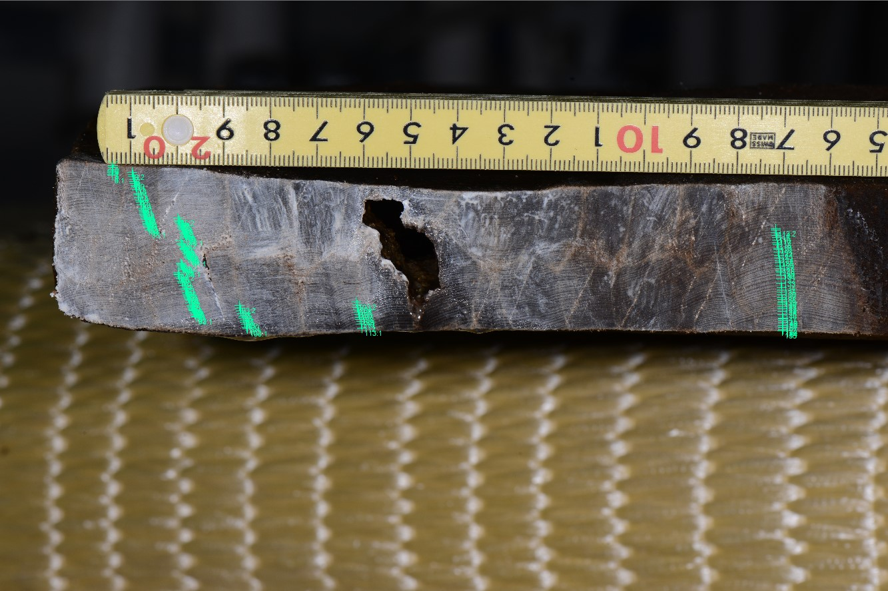

# Lesson 5  Trace evidence through a specimen ID

About eight minutes, replacing one case-reading activity. Use the printed evidence below; web exploration can wait until revision.

[Nara National Research Institute for Cultural Properties, 2024. CC BY 4.0.](https://doi.org/10.24484/sitereports.cultural_data.2044)

| Field | Information in the public record |
| --- | --- |
| ID and object | 29ho018: lower well-frame board A1, well SE9650 |
| Species | Hinoki cypress (Chamaecyparis obtusa) |
| Images | YH1_9812.JPG; annotated YH1_9812_29ho018.jpg |
| Width series | 29ho018.csv: 155 rings, inner to outer, in 0.01 mm |
| First three values | 32, 44, 42 = 0.32, 0.44, 0.42 mm |
| Not supplied in this CSV | Calendar years, reference chronology, match statistics, felling date |

**Connect the ID, image and width series. Correct the claim that 155 rings means the timber is 155 years old. What additional record is needed to assess its dating?**

[Nabunken 29ho018, CC BY 4.0](https://doi.org/10.24484/sitereports.cultural_data.2044)

<!-- pagebreak -->

# Lesson 5  Public data and the basis of interpretation

## Check

155 is the number of measured rings, not elapsed years before the present. The CSV has no calendar-year column. Images and widths support checking the measurements. Assessing the date also requires the reference chronology, overlap, match results and their evaluation.

Follow the dataset description, metadata, specimen image and CSV, then the relevant dendrochronology section of Monograph 103. Record the reported date, outermost condition and basis of crossdating. Mark an unlocated item as unverified rather than filling it by inference.

| Claim | Additional evidence |
| --- | --- |
| Calendar year of each ring | Reference series, candidate alignments, overlap, visual and statistical checks |
| Felling date | Bark edge, sapwood and wood lost through working |
| Construction and use of the well | Excavation context, stratigraphy, other finds and reuse traces |

**If 29ho017 is used for comparison, does a separate board necessarily represent a separate tree?**

Different boards could come from one tree. Different IDs alone do not establish biological independence.

[Dataset entry](https://sitereports.nabunken.go.jp/ja/search-cultural-data-repository/item/74)

[Nabunken Monograph 103: excavation report](https://doi.org/10.24484/sitereports.138817)
