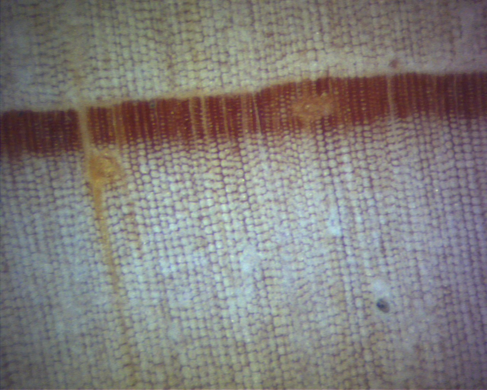
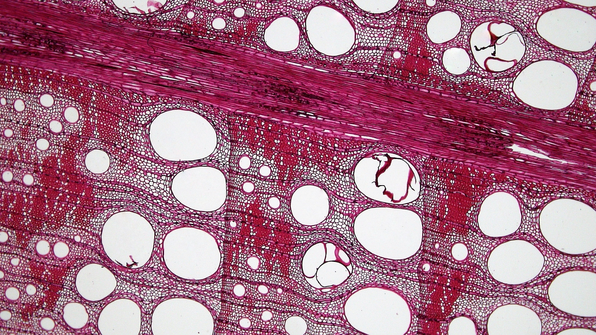
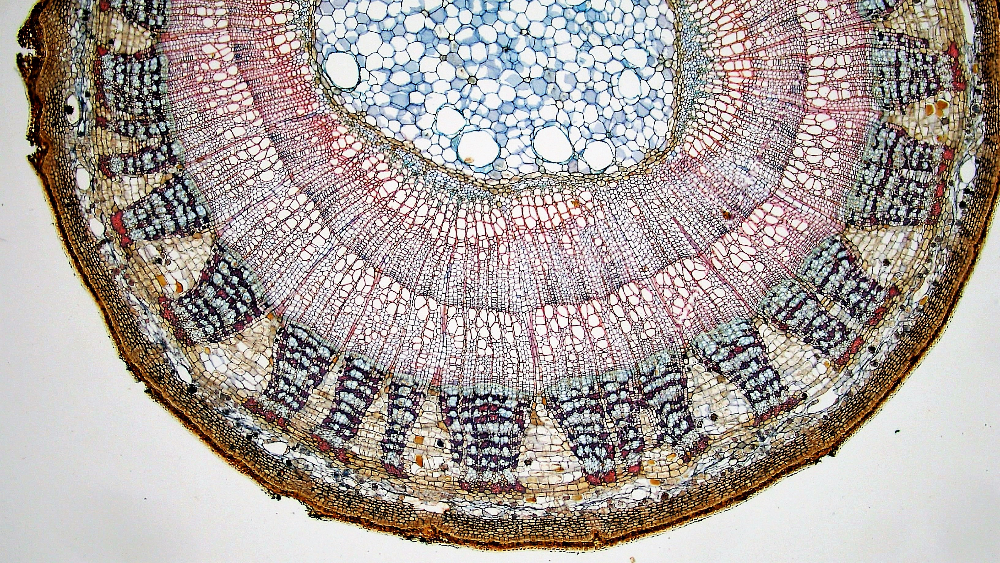
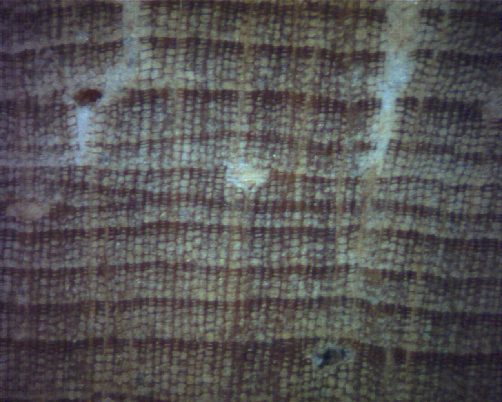
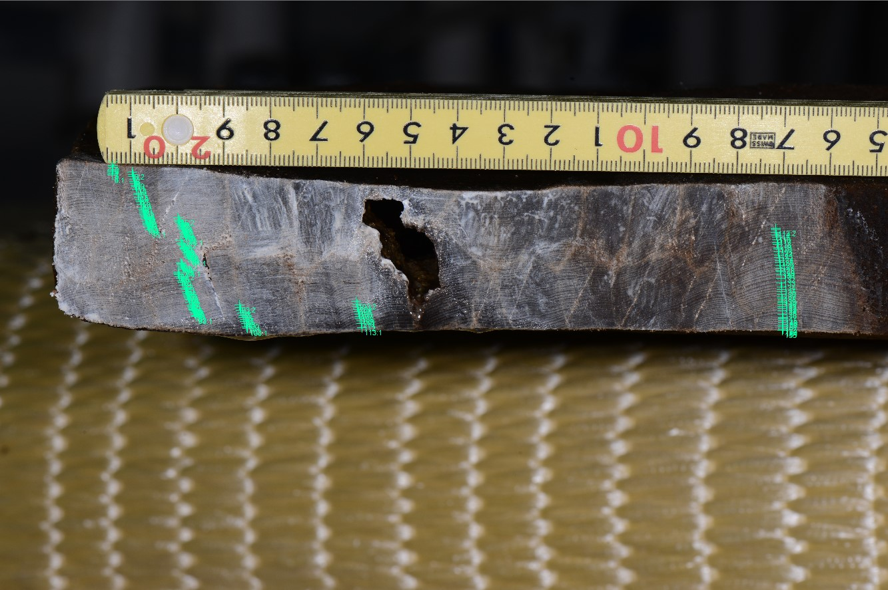

# Lesson 1  Connecting tree rings and radiocarbon

For slide 11 and Lesson 3, slide 13. A four-minute check; no preparation is required for Lesson 1.

## Two clocks, connected by known-age wood

Crossdate rings to establish their calendar years. Measure their radiocarbon content. Many pairs of known calendar ages and measured radiocarbon ages provide evidence for a calibration curve. Tree rings are a major source of calibration data, but do not supply the entire curve.

For an unknown sample, use the relationship in the other direction: compare the radiocarbon measurement and its uncertainty with an appropriate curve to obtain calendar-age ranges and probabilities. Atmospheric radiocarbon has varied, so subtracting a radiocarbon age from 1950 does not by itself give a calendar year.

| Question | Evidence needed |
| --- | --- |
| Calendar age of a ring | Crossdating against a securely dated reference |
| Calendar age of an unknown sample | Radiocarbon measurement, uncertainty and suitable curve |
| Date of an archaeological activity | Relationship between growth, use, deposition and the activity |

**Why measure radiocarbon in wood whose calendar age is already known? Explain the separate roles of crossdating and radiocarbon measurement.**

## Check

The independently known calendar age makes the ring a calibration reference. Irregularities in the curve can produce several possible calendar-age ranges for one measurement.

[Historic England: radiocarbon calibration](https://historicengland.org.uk/images-books/publications/radiocarbon-dating-chronological-modelling/the-bayesian-process/)

<!-- pagebreak -->

# Lesson 2  Compare real wood anatomy

For slides 15–17. These are different specimens at different magnifications; do not compare cell sizes directly between panels.

[Taxelson, 2009. Public domain.](https://commons.wikimedia.org/wiki/File:Earlywood-latewood_PISY.jpg)

[Berkshire Community College Bioscience Image Library. CC0 1.0.](https://commons.wikimedia.org/wiki/File:Woody_Dicot_Stem_Cross_Section_Quercus_Wood_40x_(34991087693).jpg)

**Locate a candidate ring boundary in each image and describe one feature other than colour that supports it.**

<!-- pagebreak -->

# Lesson 2  Diffuse porosity and discontinuous rings

[Berkshire Community College Bioscience Image Library. CC0 1.0.](https://commons.wikimedia.org/wiki/File:Woody_Dicot_Stem_Two_Annual_Rings_in_Tilia_(35031940521).jpg)

[Taxelson, 2009. Public domain.](https://commons.wikimedia.org/wiki/File:MissingRingPISY.jpg)

**If a ring cannot be seen in one direction, can we conclude that the whole tree stopped growing that year?**

## Interpretation

Tracheid lumina and walls help identify conifer ring boundaries. Concentrated large earlywood vessels help in ring-porous wood. In diffuse-porous wood, also examine boundary cells and their arrangement. A discontinuous ring pinches out locally: check other radii and specimens. This image alone cannot establish the number of absent years.

Staining and lighting affect colour. A false ring is an intra-annual feature, distinct from a locally discontinuous ring. The existing reference link to Japanese birch (Betula maximowicziana) remains available.

<!-- pagebreak -->

# Lesson 3  Make a skeleton plot from measurements

About eight minutes, replacing the synthetic Exercise A on slides 14–16. These are the innermost 15 measured rings of well-frame boards A1 (29ho018) and C5 (29ho017), published by Nabunken. Equal ring indices do not imply equal calendar years.

| Ring index | 29ho018 (0.01 mm) | 29ho017 (0.01 mm) |
| --- | --- | --- |
| 1 | 32 | 67 |
| 2 | 44 | 85 |
| 3 | 42 | 69 |
| 4 | 52 | 74 |
| 5 | 47 | 83 |
| 6 | 39 | 124 |
| 7 | 23 | 98 |
| 8 | 65 | 147 |
| 9 | 75 | 128 |
| 10 | 52 | 114 |
| 11 | 42 | 97 |
| 12 | 49 | 90 |
| 13 | 44 | 75 |
| 14 | 34 | 30 |
| 15 | 34 | 63 |

**Mark conspicuously narrow rings in 29ho018. Draw equally spaced indices 1–15 and longer vertical marks for relatively narrower rings. Repeat for 29ho017 and compare the spacing between features.**

Do not use measured width directly as mark length. Omit ordinary rings. This 15-ring excerpt teaches the procedure; it is not sufficient evidence for dating.

[Measured data: Nabunken 29ho018, CC BY 4.0](https://doi.org/10.24484/sitereports.cultural_data.2044)

[Comparison specimen: 29ho017, CC BY 4.0](https://doi.org/10.24484/sitereports.cultural_data.2043)

<!-- pagebreak -->

# Lesson 3  Why withhold a date?

## Example interpretation

In 29ho018, ring 7 (0.23 mm) is conspicuously narrow. Rings 14 and 15 (0.34 mm each) are narrower than ring 13 (0.44 mm), but the excerpt does not show the outer neighbour of ring 15. In 29ho017, ring 14 (0.30 mm) stands out. Mark lengths reflect relative judgements, so there is no unique numerical answer.

A partial match in a short excerpt does not establish a calendar date. Examine the full series, images and a securely dated reference. The records describe separate boards, but do not establish that they came from separate trees. Separate files are not necessarily independent biological replicates.

## Read the Yoshino specimen coverage (slide 25)

| Calendar year | Specimens present | Measured radii |
| --- | --- | --- |
| 1636 | 1 | 1 |
| 1650 | 2 | 3 |
| 1700 | 6 | 7 |
| 1800 | 24 | 30 |
| 2000 | 57 | 69 |
| 2018 | 13 | 18 |

**How does replication differ between 1636 and 1800? Should two radii from the same tree count as two independent trees?**

Counts are recalculated from the first and last years of specimens associated with the published study. Coverage describes replication, not a direct measure of dating correctness or reconstruction skill.

[Yonenobu et al. (2026): Yoshino cedar](https://doi.org/10.1016/j.dendro.2026.126572)

<!-- pagebreak -->

# Lesson 4  Calculate ring-width indices on paper

For Exercise B on slide 24. About six minutes; no computer or CSV import is needed. These are synthetic values for practising the calculation, separate from the measured Nabunken data.

Each cell gives observed width / supplied growth-curve value, both in mm. Index = observed width divided by curve value. Curve fitting itself is not part of this exercise.

| Year | Tree A | Tree B | Tree C |
| --- | --- | --- | --- |
| 1998 | 2.26560 / 1.88800 | 1.92698 / 1.60582 | 1.09175 / 1.21306 |
| 1999 | 1.65469 / 1.83854 | 1.24045 / 1.55056 | 1.18460 / 1.18460 |
| 2000 | 1.96986 / 1.79078 | 1.94705 / 1.49773 | — |

**Calculate each index to two decimal places. Average only available trees with equal weights, and record n. What happens if missing C in 2000 is replaced by zero?**

## Check

| Year | Indices A, B, C | Mean | n |
| --- | --- | --- | --- |
| 1998 | 1.20, 1.20, 0.90 | 1.10 | 3 |
| 1999 | 0.90, 0.80, 1.00 | 0.90 | 3 |
| 2000 | 1.10, 1.30, missing | 1.20 | 2 |

Filling the missing value with zero gives a mean of 0.80, inventing a growth decline that was not observed. Do not count multiple radii from one tree as independent trees.

## Return to the measured data

In the original 29ho018 CSV, 32 means 0.32 mm. The first seven widths sum to 2.79 mm. This is a sum of published measurements, not a new measurement from the printed photo. Check the original scale and measurement path; document positions and uncertainty if remeasuring.

[29ho018: source image and measurements](https://doi.org/10.24484/sitereports.cultural_data.2044)

<!-- pagebreak -->

# Lesson 5  Trace evidence through a specimen ID

About eight minutes, replacing one case-reading activity. Use the printed evidence below; web exploration can wait until revision.

[Nara National Research Institute for Cultural Properties, 2024. CC BY 4.0.](https://doi.org/10.24484/sitereports.cultural_data.2044)

| Field | Information in the public record |
| --- | --- |
| ID and object | 29ho018: lower well-frame board A1, well SE9650 |
| Species | Hinoki cypress (Chamaecyparis obtusa) |
| Images | YH1_9812.JPG; annotated YH1_9812_29ho018.jpg |
| Width series | 29ho018.csv: 155 rings, inner to outer, in 0.01 mm |
| First three values | 32, 44, 42 = 0.32, 0.44, 0.42 mm |
| Not supplied in this CSV | Calendar years, reference chronology, match statistics, felling date |

**Connect the ID, image and width series. Correct the claim that 155 rings means the timber is 155 years old. What additional record is needed to assess its dating?**

[Nabunken 29ho018, CC BY 4.0](https://doi.org/10.24484/sitereports.cultural_data.2044)

<!-- pagebreak -->

# Lesson 5  Public data and the basis of interpretation

## Check

155 is the number of measured rings, not elapsed years before the present. The CSV has no calendar-year column. Images and widths support checking the measurements. Assessing the date also requires the reference chronology, overlap, match results and their evaluation.

Follow the dataset description, metadata, specimen image and CSV, then the relevant dendrochronology section of Monograph 103. Record the reported date, outermost condition and basis of crossdating. Mark an unlocated item as unverified rather than filling it by inference.

| Claim | Additional evidence |
| --- | --- |
| Calendar year of each ring | Reference series, candidate alignments, overlap, visual and statistical checks |
| Felling date | Bark edge, sapwood and wood lost through working |
| Construction and use of the well | Excavation context, stratigraphy, other finds and reuse traces |

**If 29ho017 is used for comparison, does a separate board necessarily represent a separate tree?**

Different boards could come from one tree. Different IDs alone do not establish biological independence.

[Dataset entry](https://sitereports.nabunken.go.jp/ja/search-cultural-data-repository/item/74)

[Nabunken Monograph 103: excavation report](https://doi.org/10.24484/sitereports.138817)

<!-- pagebreak -->

# Lesson 6  Compare an earthquake hypothesis with other evidence

For slide 28, about six minutes. This exercise summarises published research; it does not report new measurements.

| Evidence | What it contributes / limitation |
| --- | --- |
| Tree-ring record | Strong growth suppression beginning in 1813 was reported in trees near the fault at Wrightwood. A growth change alone does not identify its cause. |
| Historical record | A damaging earthquake occurred on 8 December 1812. Damage and timing information came from sources other than rings; the location and magnitude remain uncertain. |
| Useful comparisons | Were trees away from the fault also suppressed? Are wounds, tilting or root damage present? Check the original study and its controls. |

**Could an earthquake in winter 1812 produce narrow rings beginning in 1813? Name evidence that helps distinguish earthquake damage from drought. Can ring widths alone establish the day of the earthquake?**

## Check

Damage during dormancy can affect the following growing season. Compare spatial concentration near the fault, damage traces, trees farther away and independent historical accounts. The exact date comes from historical evidence, not ring widths alone.

The SCEDC account also incorporates dendrochronological research. Its historical evidence is the independent component; counting a summary article as an additional independent result would double-count evidence.

[Jacoby, Sheppard & Sieh (1988), Science 241:196–199](https://doi.org/10.1126/science.241.4862.196)

[SCEDC: 1812 Wrightwood earthquake](https://scedc.caltech.edu/earthquake/wrightwood1812.html)

<!-- pagebreak -->

# Lesson 7  Read the axes and legend in an original figure

For slide 27. Use this enlargement in print. Ohyama et al. (2013), Figure 3(a), concerns March–May temperature in northeastern Asia.

[Ohyama et al., 2013, Fig. 3(a). CC BY 3.0.](https://doi.org/10.5194/cp-9-261-2013)

| Line | Axis and meaning |
| --- | --- |
| Solid black | Left: estimated temperature |
| Dotted black | Left: filtered observations |
| Dotted orange | Right: unfiltered observations |

**Identify the appropriate axis before comparing values. Does agreement in this panel establish predictive performance for unseen years?**

This is the 1887–1990 calibration fit, not an independent validation plot. Vertical separation of lines on different axes is not directly a temperature difference.

[Ohyama et al. (2013), Fig. 3(a), CC BY 3.0](https://doi.org/10.5194/cp-9-261-2013)

<!-- pagebreak -->

# Lesson 7  What does CE compare?

## In one sentence

The coefficient of efficiency, CE, measures the reduction in squared prediction error relative to predicting the verification-period observed mean in every year.

CE = 1 − Σ(observed − predicted)² / Σ(observed − verification mean)²

| CE | Interpretation |
| --- | --- |
| 1 | Perfect predictions for these verification data |
| 0 | Same squared error as the verification-mean benchmark |
| Negative | Larger squared error than that benchmark |

The mean is a retrospective benchmark used to assess predictions; it is not assumed to be known when forecasting unseen years. The expression is undefined if the observed verification series is constant.

**Table 2 reports split-period CE values of 0.019 and −0.040. Do both support a stable reconstruction? Distinguish the roles of Figure 3(a) and Table 2.**

## Check

The first represents only a small improvement over the benchmark; the second performs worse. A convincing calibration plot cannot substitute for independent testing. Consider periods, processing and validation design. The processed series in this study also cannot directly recover the long-term warming trend.

[Ohyama et al. (2013), Table 2](https://doi.org/10.5194/cp-9-261-2013)

<!-- pagebreak -->

# Lesson 8  Develop one question in 45 minutes

Write and submit in the final 45 minutes of the class. The final report is the sole basis of grading; classroom participation and learning behaviour are not graded.

## Scope

Choose one case discussed in class, or a specific subject of your own. Write either a research proposal or a case review in about four paragraphs. New experiments, measurements or literature searches are not required.

| Paragraph | Content |
| --- | --- |
| 1 | Define one question, subject, region and period. |
| 2 | Explain which tree-ring evidence and methods address it. |
| 3 | Discuss one alternative explanation and evidence for comparison. |
| 4 | State the limits of the conclusion and what to check next. |

A practical guide is about 250–400 English words. This is not a minimum or a grading criterion. A shorter report can meet the criteria if its evidence and reasoning are sufficient. Use a short title that states your question in the task field of the supplied paper.

Course materials and notes are allowed; internet access is unnecessary. A reference such as “Lesson 5, slide 7” is sufficient to identify a course source. There is no required number of references or figures. Distinguish proposed work from completed measurements.

## Suggested time allocation

Five minutes to choose a question and evidence; 30 minutes to write; ten minutes to check reasoning, alternatives, limits and identification details. Timing choices are not graded.

<!-- pagebreak -->

# Lesson 8  A short example and the rubric

This fictional building and its dates illustrate reasoning. This is not a required answer to copy; build your own question and evidence.

1. I ask how far timber can constrain a building date. In this fictional practice case, the last surviving ring of a beam is assigned to 1750, while a documentary record concerns 1758. Neither bark nor sapwood survives. Are the ring date and construction date interchangeable?

2. I would first inspect support for the 1750 assignment: the securely dated reference, overlap, matching features and investigation of mismatches. The exercise provides no crossdating record, so 1750 is a stated assumption, not a result I have independently established.

3. Lesson 5 explains why loss of the outer wood matters. The last surviving ring does not alone fix the felling year; later rings may have been removed. Even if the document concerns construction, it may not apply to this beam. Later repair or reuse of older timber are alternative explanations.

4. Neither felling nor original construction is established by these facts alone. I would examine the original document and the part of the building it describes, joints and working traces, and other timbers retaining their outer edges. Comparing their dates could help distinguish a single construction episode from repair or reuse. Source for the principle: Lesson 5, slides 5–8. The building and dates are fictional practice assumptions.

| Criterion (20 points each) | Where it appears in the example |
| --- | --- |
| Question and scope | 1: subject and distinction between dates |
| Evidence and methods | 2: what must support the crossdate |
| Comparison and logic | 3: loss of wood, repair, reuse and documentary context |
| Evidence and referencing | 3–4: source location and separation of fictional assumptions |
| Conclusion, limits and next steps | 4: limits and specific additional evidence |

Total: 100 points. Use 20, 15, 10 or 5 as attainment guides for each criterion; no relevant statement receives 0. Length or format alone does not determine a full score; judge the reasoning and evidence actually presented.
