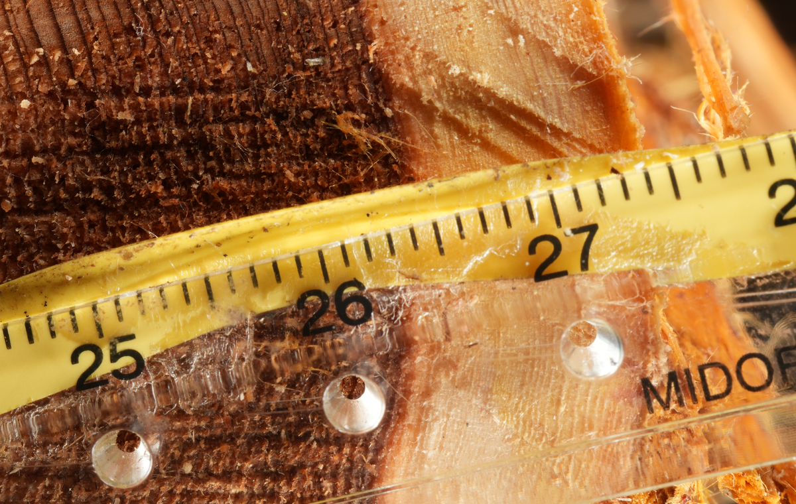
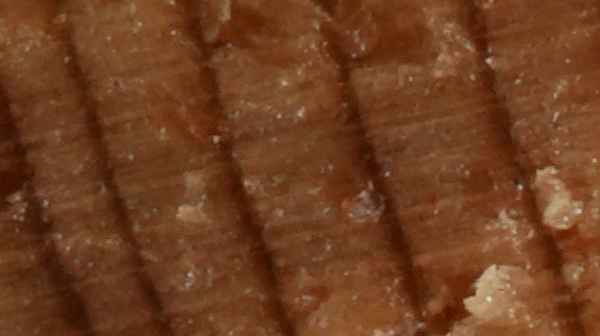
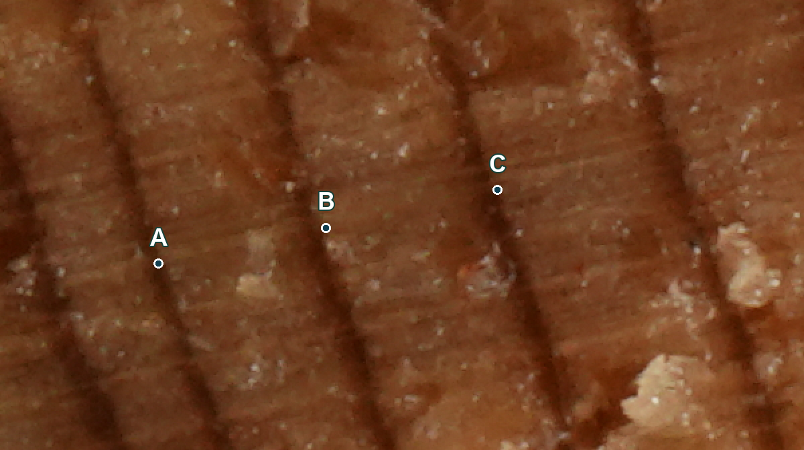

# Digital images and tree-ring measurement

An introductory supplement for Lesson 4, slides 13–17. Learn how measurement accuracy, image sampling and saved data relate, using actual Koyamaki research material.

## Pixels are the elements of a digital image

A digital photograph is an array of pixels carrying colour and brightness values. A large total pixel count does not necessarily resolve fine ring boundaries if the photograph covers a wide area.

Koyamaki end grain from Kiso, photographed with a scale. A known length relates pixel distances to physical distances. This overview has been reduced for display.

## mm/pix: specimen length represented by one pixel

At 0.005 mm/pix, one pixel represents 0.005 mm on the specimen. Smaller values mean finer sampling of the same length. This supplement uses mm/pix to describe pixel spacing.

<!-- pagebreak -->

# Calibration and the 0.01 mm requirement

## Relate pixels to a known length

Select a known interval on a scale placed in the specimen plane. Divide its physical length by the number of pixels spanning it.

Calibration (mm/pix) = known length (mm) / pixel count (pix)

Example: 10 mm spans 2000 pixels, giving 10 / 2000 = 0.005 mm/pix. A boundary separation of 60 pixels then gives 60 × 0.005 = 0.30 mm. These example numbers are for practising the calculation.

## Image sampling and actual accuracy are different

Required ring-width measurement accuracy is 0.01 mm. Check the imaging condition of pixel spacing at most 0.01 mm/pix. This alone does not guarantee accuracy: focus, surface preparation, distortion, scale placement and boundary identification also matter.

The calibration recorded for the original photograph gives about 0.0058 mm/pix. This is pixel spacing, not a demonstrated measurement accuracy of 0.0058 mm.

## Check your understanding

With the same pixel count, what happens to mm/pix if you photograph twice the width of the specimen?

Explanation: all else equal, each pixel represents twice the length, so sampling becomes coarser. Total camera pixel count alone cannot establish suitability for measurement.

<!-- pagebreak -->

# Display size and image information

The same specimen area is shown at the same display size. The right image was reduced to one quarter of its pixel count along each dimension, then enlarged for display.

Left: 600×336 pixels, about 0.0058 mm/pix. Right: 150×84 pixels, about 0.0232 mm/pix. The right image does not meet the condition of at most 0.01 mm/pix.

## Zooming and resampling

Display zoom changes how large the image looks; it adds no source information. Downsampling discards detail, which cannot be recovered simply by enlarging the result.

## Cropping is different from downsampling

Cropping without resampling preserves mm/pix while reducing the visible area. Resampling to fewer pixels changes mm/pix, so update the calibration before measuring that image.

## Keep the original

Retain the measurement image and make a separate display copy. Repeated JPEG saves, strong compression or excessive enhancement can alter fine detail. Record any processing and its version.

<!-- pagebreak -->

# Connect photographs, POS and rwl files

A, B and C redraw three positions saved in CooRecorder, displayed in the same order as the rwl values. The labels are not calendar years.

| Interval | rwl value | Ring width |
| --- | --- | --- |
| A–B | 74 | 0.74 mm |
| B–C | 76 | 0.76 mm |

Values in this rwl use units of 0.01 mm: 74 × 0.01 = 0.74 mm. Recording increments and measurement accuracy are different. Extra decimal places in POS coordinates do not guarantee accuracy to those places.

The POS records measurement positions and calibration information; the rwl supplies the width series. Check path changes and sequence direction. Numbers such as 1 and 10 in this segment file are not calendar-year assignments.

Sources: [Yonenobu et al. (2026), Koyamaki study](https://doi.org/10.1016/j.dendro.2026.126565); [research data](https://doi.org/10.50974/0002007852). Research-group photograph and records: 20ko478, MO103934 and paired POS/rwl.

Further help: [ImageJ: Set Scale](https://imagej.net/ij/docs/menus/analyze.html#scale); [CooRecorder official information](https://www.cybis.se/forfun/dendro/). Software purchase or operation is not required for this supplement.
