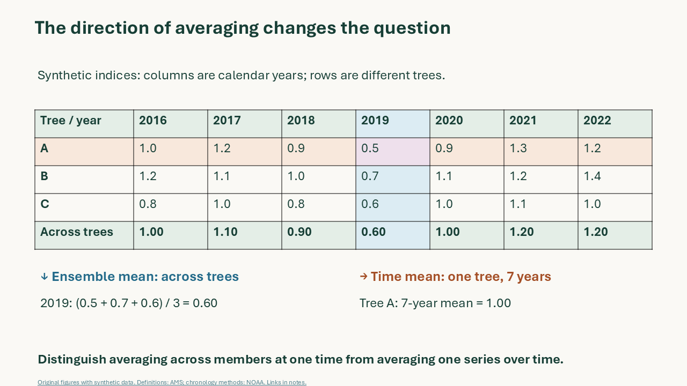
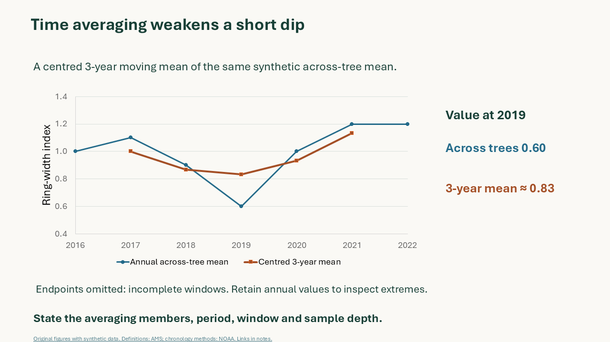

# Ensemble means and time means

Chapter 4 supplement. Building a chronology and examining its long-term variation average data in different directions. This example uses synthetic standardized ring-width indices, not observations or records of a particular climate event.

Vertically: averaging trees A–C in 2019 gives (0.5 + 0.7 + 0.6) / 3 = 0.60. This illustrates the idea of averaging members at the same time to obtain an ensemble mean.

Horizontally: averaging tree A over 2016–2022 gives 7.0 / 7 = 1.00. This time mean describes one series over a specified interval. Always state the interval and the object averaged.

In dendrochronology, calendar years must be aligned by crossdating, series standardized as appropriate for the research question, and samples from the same tree combined first. Trees share environmental influences and need not be independent, identically distributed realizations. An across-tree sample mean should not automatically be equated with the ensemble expectation of a probability model.

<!-- pagebreak -->

# Time averaging weakens short variations

The blue line averages across trees separately each year, retaining the 2019 dip to 0.60. The orange line is its centred 3-year moving mean. The value plotted at 2019 averages 2018–2020.

m_3(2019) = (0.90 + 0.60 + 1.00) / 3 ≈ 0.83

A moving mean is a time mean calculated over a sliding window. It can clarify broader variation while weakening short extremes and spreading the influence of an abrupt change to neighbouring times. The example omits 2016 and 2022 because complete centred windows are unavailable. Overlapping windows also tend to correlate neighbouring moving-mean values.

Question: which series should you inspect to compare the intensity of the 2019 dip? Answer: inspect the original annual series. Show a moving mean alongside it when useful, specifying the window and endpoint treatment. These synthetic values cannot establish a drought or any other cause of the dip.

<!-- pagebreak -->

# Equations and limits of averaging

## Distinguish the averaging indices

Let x_i(t) be the index for tree i in calendar year t, and n_t the number of available trees in that year. A simple across-tree mean is m_E(t) = [Σ_i x_i(t)] / n_t. Sum over trees with values in that year; do not replace missing values with zero. Actual chronology methods may use robust estimators rather than simple arithmetic means.

For T equally spaced times, the time mean of tree i is m_T(i) = [Σ_t x_i(t)] / T. The summation runs in a different direction. In a probability model, the ensemble mean is E[X(t)]; a finite-member mean may estimate or approximate that expectation.

## How much variability does averaging remove?

For a simple model of a shared signal plus independent zero-mean errors, each with variance σ², the error variance of an n-member mean is σ²/n. If the errors instead have a common pairwise correlation ρ, it becomes σ²[1 + (n − 1)ρ]/n. Increasing sample size cannot remove shared bias or strong correlation. Real data also require attention to individual differences, unequal correlations and selection bias.

## Conditions for replacing one average with another

Equating time and ensemble means involves conditions such as ergodicity; stationarity alone does not guarantee the equivalence. Climate trends or regime shifts make time means depend on the selected interval. At introductory level, explain what was averaged, when, how many members contributed, and which method was used.

Connection to Chapter 7: a period mean of temperature aggregates over time. Climate-model ensemble means average simulations representing the same target time. A mean across observation locations is a spatial mean, which must also be distinguished from a time mean.

## Sources and further reading

- [AMS: ensemble average](https://glossary.ametsoc.org/wiki/ensemble-average/), [time average](https://glossary.ametsoc.org/wiki/time-average/) and [ergodic condition](https://glossary.ametsoc.org/wiki/ergodic-condition/)
- [NOAA: tree-ring data and chronology development](https://www.ncei.noaa.gov/pub/data/paleo/treering/treeinfo.pdf)
- Figures and values are original synthetic teaching examples, not reproductions of source figures.
