# Tree growth habit and growth curves

Chapter 2 supplement. We move from conifer architecture to quantitative growth models. All figures and values are original teaching examples, not measured growth of a particular species.

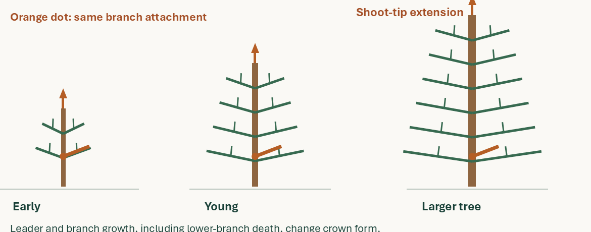

Many conifers retain a main axis, illustrating monopodial branching. Distinguish leader and branch extension from cambial thickening. Apical dominance contributes to form, but branch extension, angles and death, light, competition and damage also shape a tree. An orderly conical crown is not universal.

Pines and some other trees preform shoot structures in the previous season's buds, but additional flushing can occur. Branch-whorl counts should not automatically be interpreted as tree age. Roots extend near their tips and woody roots can thicken, while root architecture varies with species, soil and water conditions.

Within a season, shoot extension, cambial division, cell enlargement and wall formation need not begin or end together. Separate these seasonal processes from changes in tree size over decades.

<!-- pagebreak -->

# Representative deterministic growth curves

Time and parameters specify a unique prediction in a deterministic model. Random variation and observation error can be added to a statistical model. A smooth deterministic curve alone does not explain all actual annual variation.

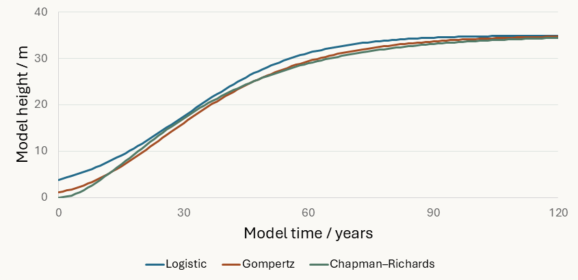

## Logistic

![H(t)=K/[1+exp{-r(t-t0)}]](assets/logistic.png)

## Gompertz

![H(t)=K exp[-exp{-r(t-t0)}]](assets/gompertz.png)

## One Chapman–Richards parameterization

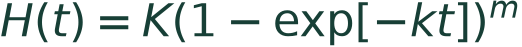

H is height, t is time, and K is the model asymptote. Rates r and k have inverse-time units; t0 is a time and m is dimensionless. The plot uses K=35 m; logistic r=0.07, t0=30; Gompertz r=0.05, t0=25; Chapman–Richards k=0.04, m=2. Time is in years. These arbitrary choices are not species-specific fits. Initial values differ; model time zero is not automatically germination.

Here K>0 and r, k>0. Use this Chapman–Richards form for t≥0; it is sigmoid when m>1. Inflection heights are K/2 for the logistic and K/e for the Gompertz curve. Check parameterization as well as model names.

<!-- pagebreak -->

# Size, absolute rate and relative rate

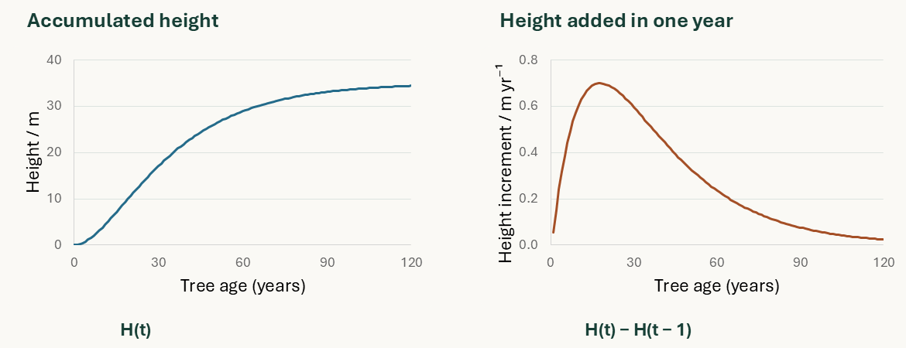

The annual increment is ΔH(t)=H(t)−H(t−1), measured in metres. Dividing a one-year increment by one year gives an average rate in m/year. In continuous time, use derivatives:

Absolute growth rate, AGR, has units m/year; relative growth rate, RGR, has units per year. RGR measures the rate per unit current size and is defined for H>0. It is distinct from a standardized tree-ring index.

Logistic and Gompertz derivatives can be written as follows; ln denotes the natural logarithm:

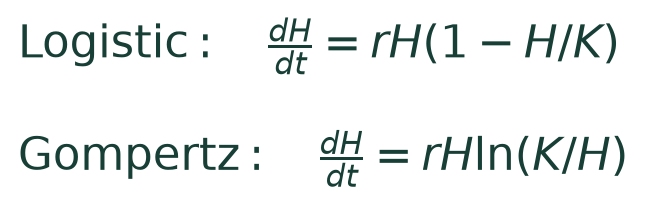

For the chosen Chapman–Richards parameterization:

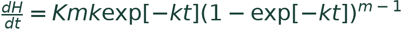

Slowing height increment near the asymptote does not establish an identical pattern in diameter, volume or mass increment. Check parameters, initial conditions, the fitted interval and residuals. Extrapolate cautiously when suppression, release or disturbance interrupts a series.

<!-- pagebreak -->

# Ring width and basal area increment

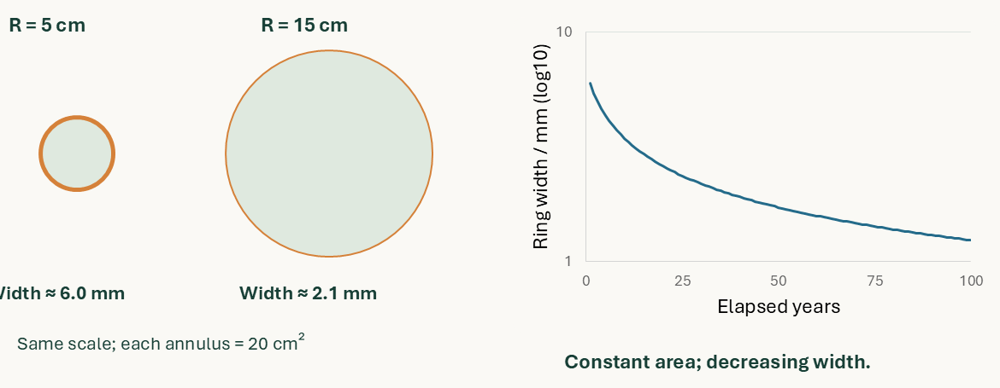

Assume a circular, concentric wood section without bark. Let R be the previous radius and w the new ring width. Basal area increment, BAI, is the annulus area:

![BAI=pi[(R+w)^2-R^2]=pi(2Rw+w^2)](assets/bai.png)

For a constant BAI of B, solve for w. The approximation requires w to be small relative to R:

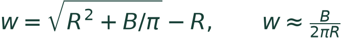

B=20 cm² gives w≈6.01 mm at R=5 cm and w≈2.11 mm at R=15 cm. The time-series example also holds B constant and uses a log10 vertical axis. Ring width declines despite constant area increment. Actual BAI need not be constant, and converting to BAI does not remove every age- or size-related trend.

BAI is a sectional quantity, not whole-stem volume increment or whole-tree mass increment. Check eccentricity, discontinuous rings, missing pith and sampling height, and document limitations of a single radial measurement. This leads into standardization in Chapter 4.

<!-- pagebreak -->

# Linking allometry with change through time

A growth curve relates time to size. Allometry relates different quantities, such as diameter D and mass M. A basic power model is M=aD^b. Coefficients depend on the target and units; b is not a universal constant across species.

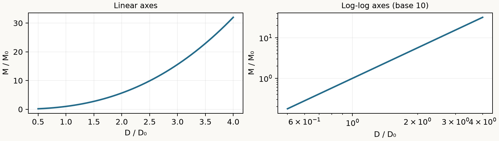

The example uses M/M0=(D/D0)^2.5 without fitting data. Normalizing by reference quantities D0 and M0 gives the log form below. The log-log slope corresponds to exponent b:

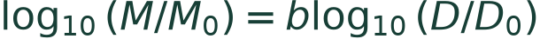

If the same relationship holds along an individual tree's trajectory, with a and b constant, the chain rule gives:

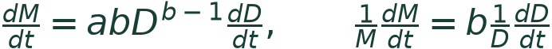

Example: with b=2.5, doubling diameter while halving diameter growth rate gives a mass-growth-rate ratio of 2^1.5×0.5≈1.41. Reduced radial or diameter increment alone does not determine the change in mass increment. However, a relationship fitted across different individuals need not hold along one individual's trajectory. Check the mass component, species, diameter range and parameter uncertainty.

<!-- pagebreak -->

# Sources and further reading

- Avery & Burkhart (1994). Forest Measurements, 4th ed., pp. 303–305 (consulted local copy).
- [Meinzer et al., eds. (2011), Size- and Age-Related Changes in Tree Structure and Function](https://doi.org/10.1007/978-94-007-1242-3), chapters 4 and 6 (consulted local copy).
- [Pommerening & Muszta (2015): growth modelling](https://doi.org/10.1186/s40663-015-0029-4); [Biondi & Qeadan (2008): ring width and area](https://research.fs.usda.gov/treesearch/32501).
- [Chojnacky et al. (2014): biomass equations](https://doi.org/10.1093/forestry/cpt053); [Stephenson et al. (2014): size and mass accumulation](https://doi.org/10.1038/nature12914).
- [Iowa State: tree growth habit](https://naturalresources.extension.iastate.edu/forestry/tree_biology/101.html); [Punches (2004): tree growth and wood](https://www.cof.orst.edu/cof/fs/kpuettmann/FS%20533/PNW576.pdf).
