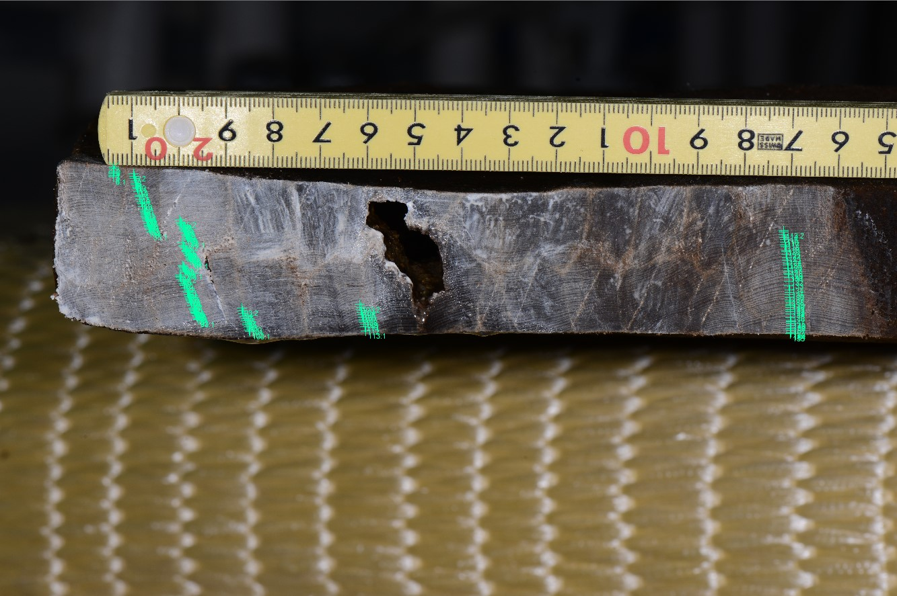

# 第5回　年輪考古学：配布資料
樹木年輪で読む環境と歴史｜90分｜初稿 v1｜2026年10月30日

## 今日の問い
年輪の暦年が分かったとき、人間の活動の時期をどこまで言えるだろうか。到達目標は、最外輪・伐採・建築の年代を区別し、保存状態と文脈（context）から結論と限界を説明することである。

## 年代を解釈する順序
1. 樹種・測線・試料の残り方を確認し、年輪系列を照合する。
2. 最終残存輪（last preserved ring）が、元の最外輪かを確認する。
3. 樹皮直下の外表面（bark edge）、辺材（sapwood）、心辺材境界を記録する。
4. 最終成長と伐採（felling）、加工・保管、建築・使用を分ける。
5. 部材位置、接合、加工痕、修理記録、出土状況と合わせて解釈する。

## 大切な留保
樹皮側が完存していても、枯死した木が後から伐られた可能性を検討する。成長を終えた最外輪からは、翌年の成長開始前までの休眠期を示す場合があり、暦年をまたぐことがある。形成途中の年輪の季節解釈には、樹種と立地の形成季節の知識が必要である。

上限年代（terminus post quem; TPQ）は「この年より前ではない」という制約であり、建築年の確定値ではない。外側の欠失量が不明なら、新しい側の限界は定まらない。辺材輪数の推定には樹種・地域・個体群に対応するモデルが必要であり、一定の輪数を普遍的に足してはいけない。

## 記録の最小項目
試料ID、部材位置と関係、樹種、測線、最終残存輪、樹皮・辺材の保存状態、照合の根拠、年代の意味、仮定と代替解釈。年代が出なかった部材も記録する。複数部材が同一個体から作られた可能性にも注意する。

<!-- pagebreak -->
# 演習A　伐採の時期をどう絞るか
8分：個人で4分、二人で3分、結論の記録1分。

以下はすべて教材用の架空例であり、実測データではない。

| ID | 観察・条件 | 年代情報 |
| --- | --- | --- |
| A | 樹皮直下まで完存。最外輪は形成途中。生きていた木を形成期に伐ったと仮定し、当該立地の形成季節は既知とする。 | 最外輪1600年 |
| B | 心材のみが残る。元の最外輪と欠失量は不明。 | 最終残存輪1580年 |
| C | 心辺材境界が確認され、辺材は5輪残る。総辺材輪数を15〜25輪と仮定する。 | 心材の最終輪1590年、残存辺材1591〜1595年 |

## 各試料について答える
1. 伐採年代について、確定できること・推定できること・不明なことは何か。
2. 建築年代は決められるか。理由を示す。
3. 結論を強めるために、追加で調べる資料を一つ挙げる。

<!-- writing-space -->
## Cの計算欄
心材の最終輪の年＋推定する総辺材輪数＝（　　）〜（　　）年。

または、残存辺材の最終輪の年＋推定する欠失辺材輪数＝（　　）〜（　　）年。

<!-- writing-space -->
この15〜25輪は計算練習のための仮定であり、日本の特定樹種に適用できる実証モデルや、実測に基づく信頼区間ではない。Cでは、最終成長年を伐採暦年の概算に使い、休眠期が暦年をまたぐなどの季節の不確実性は別途検討する。

<!-- pagebreak -->
# 演習B　建築・修理・転用
8分：解釈3分、代替解釈の比較3分、記録2分。すべて架空例。

| ID | 位置・観察 | 年代情報 |
| --- | --- | --- |
| P1〜P3 | 主架構の当初部材と仮定。樹皮直下まで完存。形成期に生立木を伐採したとする。 | 最外輪1600、1601、1601年 |
| R1・R2 | 屋根。樹皮直下まで完存。同様に形成期に生立木を伐採したとする。 | 両材とも最外輪1640年 |
| X | 梁。心材のみで外側の欠失量不明。使われない仕口がある。 | 最終残存輪1530年 |

## 問い
1. 主架構について、言える最も強い年代の制約は何か。
2. 屋根材が示す建築履歴の仮説を一つ示す。
3. Xは転用材（reused timber）と断定できるか。他の説明も示す。
4. 仮説を比較する追加資料を一つ選び、何を確認するか書く。

<!-- writing-space -->
## 根拠の強さを区別する
「観察されたこと」「仮定に基づく推論」「まだ決まらないこと」の三つに分けて短く書く。年代が集中しても、保管期間や同一個体由来の可能性が自動的に消えるわけではない。当初部材という仮定が外れれば、主架構の結論も再検討する。

## 実際の報告との比較
光谷拓実（2001、32〜33頁）は法隆寺五重塔心柱の年輪年代を594年と報告し、外周の保存と追加の3層の確認を説明している。この部材の年代だけで、建物全体の建立年を確定できるだろうか。元の写真・グラフはR31から参照する。

Rook Hall Farmの報告（R32）は、辺材が完存する試料から冬1522/23年の伐採を示し、建築を1523年またはその後1〜2年ほどと解釈する。この時間差を他の建築にそのまま足してよいわけではない。

<!-- pagebreak -->
# 用語と学習リンク
| 日本語（English） | 簡単な解説 |
| --- | --- |
| 年輪考古学（dendroarchaeology） | 木材の年輪を考古資料・歴史の研究に使う。 |
| 最終残存輪（last preserved ring） | 試料に残る最も新しい輪。元の最外輪とは限らない。 |
| 樹皮直下の外表面（bark edge） | 元の木の樹皮の直下の面。 |
| 辺材（sapwood） | 心材の外側にある木部。輪数は一定ではない。 |
| 心辺材境界（heartwood–sapwood boundary） | 辺材推定の起点となる境界。 |
| 上限年代（terminus post quem (TPQ)） | その出来事は、この年より前ではない。 |
| 伐採年代（felling date） | 木を伐った時期。年輪形成年と区別する。 |
| 建築段階（building phase） | 建築・増築・修理などの履歴の区分。 |
| 転用材（reused timber） | 以前の用途を経て利用された木材。 |
| 産地推定（dendroprovenancing） | 年輪系列などから材の由来を検討する。 |

## 一次資料・データベース
- [R30 年代解釈のガイド](https://historicengland.org.uk/images-books/publications/dendrochronology-guidelines/) — Historic England
- [R31 法隆寺五重塔心柱の年輪年代](https://repository.nabunken.go.jp/dspace/bitstream/11177/309/1/BA67898227_2001_032_033.pdf) — 奈良文化財研究所
- [R32 Rook Hall Farm の分析報告](https://historicengland.org.uk/research/results/reports/65-2018) — Historic England
- [R33 建築年輪年代データベース](https://archaeologydataservice.ac.uk/archives/collections/view/vag_dendro/overview.cfm) — Archaeology Data Service
- [R34 伊豆山権現立像：年輪の上限年代と制作年代](https://www.narahaku.go.jp/collection/p-1255-0.html) — 奈良国立博物館

## レポートへの接続
研究計画またはレビューで、対象、問い、試料の残り方、照合方法、年代解釈の仮定、代替説明を記す。最終レポートはシラバスにあるA4判2〜4頁・文献3件以上を参照する。次回は年輪生態学（dendroecology）。

復習：本日の結論と限界を約200字で整理し、参照文献を一つ追加して研究案を更新する。

<!-- pagebreak -->

# 第5回　資料IDから年代の根拠をたどる

約8分。スライドの事例読解の一つに代えて使う。写真・表だけで解ける。ウェブ参照は復習時でよい。

[Nara National Research Institute for Cultural Properties, 2024. CC BY 4.0.](https://doi.org/10.24484/sitereports.cultural_data.2044)

| 項目 | 公開資料で確認できる内容 |
| --- | --- |
| 資料ID・対象 | 29ho018／井戸SE9650 下段井戸枠横板A1 |
| 樹種 | ヒノキ（Chamaecyparis obtusa） |
| 画像 | YH1_9812.JPG／計測位置画像 YH1_9812_29ho018.jpg |
| 幅系列 | 29ho018.csv：155輪、内側から外側、単位0.01 mm |
| 最初の3値 | 32、44、42 → 0.32、0.44、0.42 mm |
| このCSVにない情報 | 各行の暦年・標準系列・照合成績・伐採年 |

**資料ID、画像、幅系列の対応を説明する。「155輪あるので155年前の木材だ」という説明を直す。年代判定を確かめるには、さらに何を読むか。**

[奈文研 29ho018：CC BY 4.0](https://doi.org/10.24484/sitereports.cultural_data.2044)

<!-- pagebreak -->

# 第5回　数値が公開されても、解釈には根拠が要る

## 確認

155は測った年輪数であり、現在からの経過年数ではない。CSVには暦年の列がない。画像と幅系列は計測の追検証に役立つが、年代判定の追検証には、基準系列・重複長・照合結果とその検討も必要になる。

資料ページから、説明ファイル→メタデータ→29ho018の画像・CSV→学報103の該当する年輪年代の章、の順にたどる。報告された年代、最外層の状態、標準年輪曲線と照合した根拠を記録する。ページに見当たらない項目は推測で補わず「未確認」とする。

| 判断したいこと | 追加で調べる資料・観察 |
| --- | --- |
| 各輪の暦年 | 基準系列、照合候補、重複年数、目視・統計の結果 |
| 伐採の時期 | 樹皮直下の最外層、辺材、加工で失われた外側 |
| 井戸の製作・使用時期 | 出土状況、層位、他遺物、転用の痕跡 |

**同じデータセットの29ho017を比較に使うとき、別の部材であることと別の木であることは同じだろうか。**

別部材でも同一個体から採られた可能性は残る。資料IDを分けるだけで独立性が保証されるわけではない。

[データセット入口](https://sitereports.nabunken.go.jp/ja/search-cultural-data-repository/item/74)

[学報103：平城京左京三条一坊一・二・八坪発掘調査報告](https://doi.org/10.24484/sitereports.138817)
