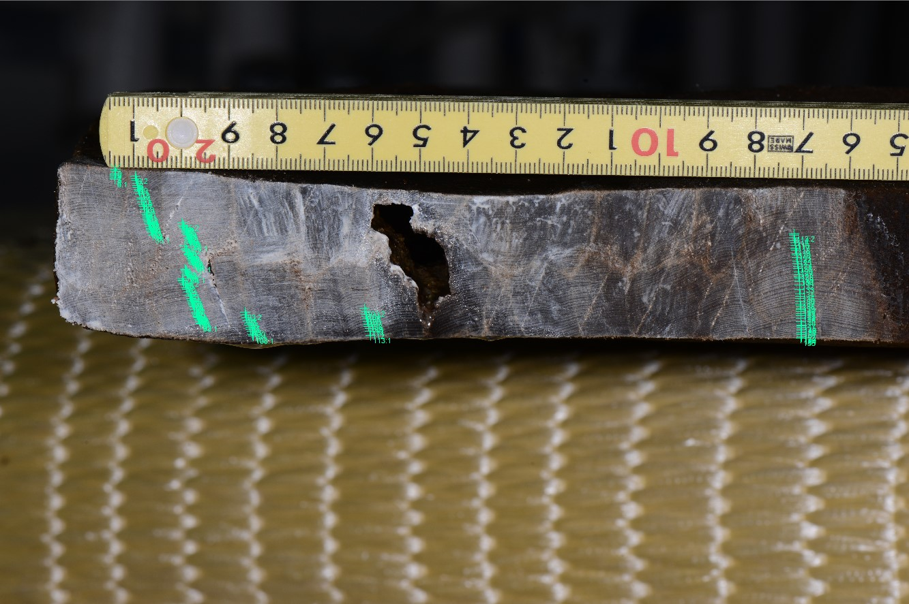

# 第5回　資料IDから年代の根拠をたどる

約8分。スライドの事例読解の一つに代えて使う。写真・表だけで解ける。ウェブ参照は復習時でよい。

[Nara National Research Institute for Cultural Properties, 2024. CC BY 4.0.](https://doi.org/10.24484/sitereports.cultural_data.2044)

| 項目 | 公開資料で確認できる内容 |
| --- | --- |
| 資料ID・対象 | 29ho018／井戸SE9650 下段井戸枠横板A1 |
| 樹種 | ヒノキ（Chamaecyparis obtusa） |
| 画像 | YH1_9812.JPG／計測位置画像 YH1_9812_29ho018.jpg |
| 幅系列 | 29ho018.csv：155輪、内側から外側、単位0.01 mm |
| 最初の3値 | 32、44、42 → 0.32、0.44、0.42 mm |
| このCSVにない情報 | 各行の暦年・標準系列・照合成績・伐採年 |

**資料ID、画像、幅系列の対応を説明する。「155輪あるので155年前の木材だ」という説明を直す。年代判定を確かめるには、さらに何を読むか。**

[奈文研 29ho018：CC BY 4.0](https://doi.org/10.24484/sitereports.cultural_data.2044)

<!-- pagebreak -->

# 第5回　数値が公開されても、解釈には根拠が要る

## 確認

155は測った年輪数であり、現在からの経過年数ではない。CSVには暦年の列がない。画像と幅系列は計測の追検証に役立つが、年代判定の追検証には、基準系列・重複長・照合結果とその検討も必要になる。

資料ページから、説明ファイル→メタデータ→29ho018の画像・CSV→学報103の該当する年輪年代の章、の順にたどる。報告された年代、最外層の状態、標準年輪曲線と照合した根拠を記録する。ページに見当たらない項目は推測で補わず「未確認」とする。

| 判断したいこと | 追加で調べる資料・観察 |
| --- | --- |
| 各輪の暦年 | 基準系列、照合候補、重複年数、目視・統計の結果 |
| 伐採の時期 | 樹皮直下の最外層、辺材、加工で失われた外側 |
| 井戸の製作・使用時期 | 出土状況、層位、他遺物、転用の痕跡 |

**同じデータセットの29ho017を比較に使うとき、別の部材であることと別の木であることは同じだろうか。**

別部材でも同一個体から採られた可能性は残る。資料IDを分けるだけで独立性が保証されるわけではない。

[データセット入口](https://sitereports.nabunken.go.jp/ja/search-cultural-data-repository/item/74)

[学報103：平城京左京三条一坊一・二・八坪発掘調査報告](https://doi.org/10.24484/sitereports.138817)
