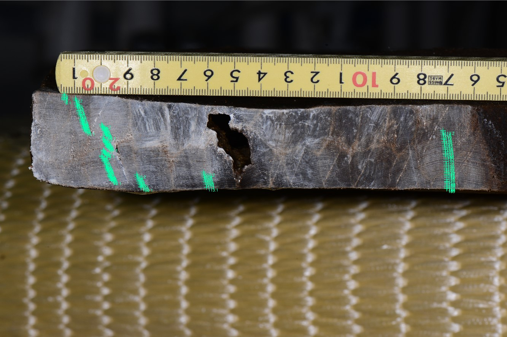

# 第1回　年輪と放射性炭素年代をつなぐ

スライド11・第3回スライド13に対応。約4分の確認。第1回の予習は不要です。

## 年輪が、二つの時計をつなぐ

① クロスデーティングで暦年を確定した年輪を用意する。② その年輪の炭素を測り、放射性炭素年代を求める。③「既知の暦年」と「測った放射性炭素年代」の組を多数集め、較正曲線の基礎資料にする。年輪は較正曲線の重要な資料だが、全期間が年輪だけで構成されるわけではない。

未知試料では逆向きに使う。測った放射性炭素年代と誤差を較正曲線に照らし、対応し得る暦年代の範囲と確率を求める。大気中の放射性炭素濃度は一定でなかったため、単純に1950年から年代値を引くだけでは暦年にならない。

| 確かめること | 必要な根拠 |
| --- | --- |
| 年輪の暦年 | 年代の確かな基準系列への照合 |
| 未知試料の暦年代 | 放射性炭素の測定値・誤差と適切な較正曲線 |
| 遺跡の活動時期 | 試料の生育・利用・堆積と活動との関係 |

**既知の暦年の年輪を測るのは、すでに分かる年代をもう一度調べるだけだろうか。年輪年代学と放射性炭素年代法の役割を一文ずつ書こう。**

## 確認

暦年が独立に分かる年輪だからこそ、放射性炭素年代を暦年代に対応づける基準になる。較正曲線には凹凸があり、未知試料の結果が複数の暦年代範囲に分かれることもある。

[Historic England：放射性炭素年代の較正](https://historicengland.org.uk/images-books/publications/radiocarbon-dating-chronological-modelling/the-bayesian-process/)

<!-- pagebreak -->

# 第2回　木材組織を実物で比べる

スライド15〜17に対応。写真は別試料・別倍率です。細胞の大きさを写真間で直接比較しません。

[Taxelson, 2009. Public domain.](https://commons.wikimedia.org/wiki/File:Earlywood-latewood_PISY.jpg)

[Berkshire Community College Bioscience Image Library. CC0 1.0.](https://commons.wikimedia.org/wiki/File:Woody_Dicot_Stem_Cross_Section_Quercus_Wood_40x_(34991087693).jpg)

**各写真で年輪界の候補を指し、色以外の根拠を一つ述べよう。**

<!-- pagebreak -->

# 第2回　散孔材と不連続年輪

[Berkshire Community College Bioscience Image Library. CC0 1.0.](https://commons.wikimedia.org/wiki/File:Woody_Dicot_Stem_Two_Annual_Rings_in_Tilia_(35031940521).jpg)

[Taxelson, 2009. Public domain.](https://commons.wikimedia.org/wiki/File:MissingRingPISY.jpg)

**一つの方向で輪を読めないとき、「この年、木全体が成長しなかった」と言えるだろうか。**

## 観察の整理

針葉樹では仮道管の内腔・壁厚、環孔材では大きな早材道管の集中が手がかりになる。散孔材でも境界付近の細胞や配列を調べる。不連続年輪は局所的に輪が途切れる現象であり、別方向・別試料を確認する。写真だけで失われた年数は確定できない。

写真の染色や照明による色は、木材本来の色とは限らない。偽年輪は輪内の変化であり、途切れる不連続年輪と区別する。マカンバの標本へのリンクは第2回の参考資料に残してある。

<!-- pagebreak -->

# 第3回　実測値でスケルトンプロットを作る

約8分。スライド14〜16の合成例の演習Aに代えて使う。奈文研の井戸枠横板A1（29ho018）とC5（29ho017）の内側から15輪を抜粋した実測値。輪番号が同じでも同じ暦年とは限らない。

| 輪番号 | 29ho018（0.01 mm） | 29ho017（0.01 mm） |
| --- | --- | --- |
| 1 | 32 | 67 |
| 2 | 44 | 85 |
| 3 | 42 | 69 |
| 4 | 52 | 74 |
| 5 | 47 | 83 |
| 6 | 39 | 124 |
| 7 | 23 | 98 |
| 8 | 65 | 147 |
| 9 | 75 | 128 |
| 10 | 52 | 114 |
| 11 | 42 | 97 |
| 12 | 49 | 90 |
| 13 | 44 | 75 |
| 14 | 34 | 30 |
| 15 | 34 | 63 |

**① 29ho018で、前後より目立って狭い輪に印を付ける。② 1〜15の目盛を横に等間隔で書き、より狭い輪に長い縦棒を描く。③ 29ho017でも行い、狭い輪の間隔を比べる。**

幅の絶対値をそのまま棒の長さにしない。普通の輪は省略し、周囲に対する狭さを表す。15輪は操作練習用であり、年代決定に十分とは扱わない。

[実測値の出典：奈文研 29ho018 / CC BY 4.0](https://doi.org/10.24484/sitereports.cultural_data.2044)

[比較資料：29ho017 / CC BY 4.0](https://doi.org/10.24484/sitereports.cultural_data.2043)

<!-- pagebreak -->

# 第3回　照合を保留する理由と試料の重なり

## 確認例

29ho018では7番（0.23 mm）が明瞭に狭い。14・15番（各0.34 mm）は13番（0.44 mm）より狭いが、この抜粋だけで15番の外側の変化は判断できない。29ho017では14番（0.30 mm）が目立つ。印の長さは相対的な判断なので、唯一の数値解はない。

この短い抜粋の一部を合わせても暦年は決まらない。全系列・原画像・年代の確かな基準と照合する。別部材として登録された試料だが、別個体の木に由来することはこのメタデータだけでは確認できない。「別ファイル」と「独立した個体」を区別しよう。

## 吉野スギの年代範囲を読む（スライド25）

| 暦年 | 記録のある試料数 | 測線数 |
| --- | --- | --- |
| 1636 | 1 | 1 |
| 1650 | 2 | 3 |
| 1700 | 6 | 7 |
| 1800 | 24 | 30 |
| 2000 | 57 | 69 |
| 2018 | 13 | 18 |

**1636年と1800年では、記録を支える試料数はどう違うか。同じ木の複数の測線を、別個体として数えてよいか。**

この表は刊行論文に対応する試料の開始年・終了年から再集計した。試料数は記録の重なりを示すが、照合の正しさや気候復元の精度を直接証明する指標ではない。

[米延ほか（2026）：吉野スギ研究](https://doi.org/10.1016/j.dendro.2026.126572)

<!-- pagebreak -->

# 第4回　紙で計算する年輪指数

スライド24の演習Bに対応。約6分。PCやCSVの読み込みは不要。以下は計算法を練習するための合成値で、奈文研の実測値とは別の資料です。

各セルは「観察幅 / 与えられた成長曲線の値」（ともにmm）。指数＝観察幅÷曲線の値。曲線はここで与えており、適合する作業は行わない。

| 年 | 個体A | 個体B | 個体C |
| --- | --- | --- | --- |
| 1998 | 2.26560 / 1.88800 | 1.92698 / 1.60582 | 1.09175 / 1.21306 |
| 1999 | 1.65469 / 1.83854 | 1.24045 / 1.55056 | 1.18460 / 1.18460 |
| 2000 | 1.96986 / 1.79078 | 1.94705 / 1.49773 | — |

**各個体の指数を小数第2位まで求める。その年に値のある個体だけを等しい重みで平均し、個体数nも書く。2000年のCを0で埋めると何が起こるか。**

## 確認

| 年 | A・B・Cの指数 | 平均 | n |
| --- | --- | --- | --- |
| 1998 | 1.20・1.20・0.90 | 1.10 | 3 |
| 1999 | 0.90・0.80・1.00 | 0.90 | 3 |
| 2000 | 1.10・1.30・欠測 | 1.20 | 2 |

2000年の欠測を0で埋めると平均は0.80となり、観察していない成長低下を作ってしまう。同じ木の複数測線を独立した個体として数えない。

## 実データの単位にも戻る

第3回の29ho018では、元CSVの32は0.32 mm。最初の7輪の幅の合計は2.79 mmである。これはCSVの和で、掲載写真から新たに実測した値ではない。原画像の尺度・測線と照合し、測り直す場合は位置と誤差を記録する。

[29ho018：原画像・計測値](https://doi.org/10.24484/sitereports.cultural_data.2044)

<!-- pagebreak -->

# 第5回　資料IDから年代の根拠をたどる

約8分。スライドの事例読解の一つに代えて使う。写真・表だけで解ける。ウェブ参照は復習時でよい。

[Nara National Research Institute for Cultural Properties, 2024. CC BY 4.0.](https://doi.org/10.24484/sitereports.cultural_data.2044)

| 項目 | 公開資料で確認できる内容 |
| --- | --- |
| 資料ID・対象 | 29ho018／井戸SE9650 下段井戸枠横板A1 |
| 樹種 | ヒノキ（Chamaecyparis obtusa） |
| 画像 | YH1_9812.JPG／計測位置画像 YH1_9812_29ho018.jpg |
| 幅系列 | 29ho018.csv：155輪、内側から外側、単位0.01 mm |
| 最初の3値 | 32、44、42 → 0.32、0.44、0.42 mm |
| このCSVにない情報 | 各行の暦年・標準系列・照合成績・伐採年 |

**資料ID、画像、幅系列の対応を説明する。「155輪あるので155年前の木材だ」という説明を直す。年代判定を確かめるには、さらに何を読むか。**

[奈文研 29ho018：CC BY 4.0](https://doi.org/10.24484/sitereports.cultural_data.2044)

<!-- pagebreak -->

# 第5回　数値が公開されても、解釈には根拠が要る

## 確認

155は測った年輪数であり、現在からの経過年数ではない。CSVには暦年の列がない。画像と幅系列は計測の追検証に役立つが、年代判定の追検証には、基準系列・重複長・照合結果とその検討も必要になる。

資料ページから、説明ファイル→メタデータ→29ho018の画像・CSV→学報103の該当する年輪年代の章、の順にたどる。報告された年代、最外層の状態、標準年輪曲線と照合した根拠を記録する。ページに見当たらない項目は推測で補わず「未確認」とする。

| 判断したいこと | 追加で調べる資料・観察 |
| --- | --- |
| 各輪の暦年 | 基準系列、照合候補、重複年数、目視・統計の結果 |
| 伐採の時期 | 樹皮直下の最外層、辺材、加工で失われた外側 |
| 井戸の製作・使用時期 | 出土状況、層位、他遺物、転用の痕跡 |

**同じデータセットの29ho017を比較に使うとき、別の部材であることと別の木であることは同じだろうか。**

別部材でも同一個体から採られた可能性は残る。資料IDを分けるだけで独立性が保証されるわけではない。

[データセット入口](https://sitereports.nabunken.go.jp/ja/search-cultural-data-repository/item/74)

[学報103：平城京左京三条一坊一・二・八坪発掘調査報告](https://doi.org/10.24484/sitereports.138817)

<!-- pagebreak -->

# 第6回　地震の仮説を別の証拠と比べる

スライド28に対応。約6分。実際の研究を要約した読解問題であり、以下は新たな計測結果ではありません。

| 証拠 | 確認できること／注意 |
| --- | --- |
| 年輪の記録 | Wrightwood付近の断層沿いの樹木に、1813年からの強い成長抑制が報告された。成長変化だけで原因は決まらない。 |
| 歴史記録 | 1812年12月8日の被害地震が知られている。年輪と別に得られた被害・時刻の情報だが、震源の位置や規模には不確実性がある。 |
| 比較すべき観察 | 断層から離れた木も同時に抑制されたか、傷・傾斜・根の損傷はあるか。原論文の比較対象と記録を確認する。 |

**① 1813年の狭い輪と1812年冬の地震は矛盾するか。② 干ばつでも狭い輪ができる。二つの仮説を比べる追加証拠を一つ挙げる。③ 年輪だけで地震の月日まで確定できるか。**

## 確認

休眠期の損傷が翌生育期からの成長に表れるなら矛盾しない。断層近傍への集中、損傷痕、離れた木との比較、独立した被害記録を検討する。月日は歴史記録からの情報であり、年輪幅だけが示した日時として書かない。

SCEDCの紹介文全体には年輪研究の成果も取り込まれている。独立した証拠として使うのは歴史記録に由来する部分であり、紹介記事をもう一つ数えるだけでは独立検証にならない。

[Jacoby, Sheppard & Sieh (1988), Science 241:196–199](https://doi.org/10.1126/science.241.4862.196)

[SCEDC：1812年Wrightwood地震](https://scedc.caltech.edu/earthquake/wrightwood1812.html)

<!-- pagebreak -->

# 第7回　原著図の軸と凡例を読む

スライド27に対応。印刷ではこの拡大図を使う。北東アジアの3〜5月気温を扱ったOhyamaほか（2013）の図3(a)。

[Ohyama et al., 2013, Fig. 3(a). CC BY 3.0.](https://doi.org/10.5194/cp-9-261-2013)

| 線 | 読む軸・意味 |
| --- | --- |
| 黒実線 | 左軸：年輪からの推定値 |
| 黒点線 | 左軸：フィルタ処理した観測値 |
| 橙点線 | 右軸：処理前の観測値 |

**線の高さを比べる前に、どの軸を使うか指で示そう。この図の一致だけで、未知期間への予測性能を確認したと言えるだろうか。**

1887〜1990年の較正期間を示す図であり、独立した検証図ではない。左右軸の異なる系列の上下関係を、そのまま温度差と解釈しない。

[Ohyama et al. (2013), Fig. 3(a), CC BY 3.0](https://doi.org/10.5194/cp-9-261-2013)

<!-- pagebreak -->

# 第7回　CEは何と比べる指標か

## 一文で言うと

CE（検証効率）は、検証期間の観測平均を毎年の予測に使う場合に比べ、モデルが二乗誤差をどれだけ減らしたかを表す。

CE = 1 − Σ(観測 − 予測)² / Σ(観測 − 検証期間の観測平均)²

| CE | 意味 |
| --- | --- |
| 1 | この検証データで予測が完全一致 |
| 0 | 検証期間の平均による一定予測と同じ二乗誤差 |
| 負 | その一定予測より二乗誤差が大きい |

平均は検証後に指標を計算するための比較基準である。未知の将来の平均が予測時に分かるという意味ではない。分母が0になる一定の観測系列では、この式は使えない。

**論文Table 2の分割検証ではCEが0.019と−0.040。両方とも十分に安定した復元と言えるか。図3(a)とTable 2の役割を分けて答えよう。**

## 確認

前者は比較基準に対する改善がわずかで、後者は基準より誤差が大きい。較正図の見た目の一致だけで独立検証を代用できない。期間・前処理・検証設計とともに判断する。この研究の処理済み系列から長期温暖化傾向をそのまま復元することもできない。

[Ohyama et al. (2013), Table 2](https://doi.org/10.5194/cp-9-261-2013)

<!-- pagebreak -->

# 第8回　45分で一つの問いを論じる

最後の45分に教室で作成・提出する。成績はレポートだけで評価し、授業中の学習状況は評価しない。

## 課題の範囲

授業で扱った事例、または自分が考えた具体的な対象を一つ選ぶ。研究計画か事例の検討のどちらかの形で、次の4点を4段落程度で説明する。新たな実験・測定・文献検索を行う課題ではない。

| 段落 | 書くこと |
| --- | --- |
| 1 | 何を知りたいか。対象・地域・時期を絞る。 |
| 2 | どの年輪資料・方法が、その問いへの証拠になるか。 |
| 3 | 別の解釈を一つ挙げ、比較する資料を説明する。 |
| 4 | 今言える範囲と限界、次に確かめることを述べる。 |

目安は日本語600〜1000字程度。短くても必要な根拠と説明がそろえばよく、字数・行数・用紙を埋める量では採点しない。配られた用紙の課題欄には、自分の問いが分かる短い題名を書く。

授業資料・メモを参照でき、ネット接続は不要。出典は「第5回、スライド7」など、参照箇所が分かる形でよい。文献数・図表の有無は採点条件にしない。研究計画は未実施の結果を作らず、仮説と確認方法を書く。

## 時間配分の目安

5分：問いと使う資料を決める。30分：4段落を書く。10分：根拠・別解釈・限界と氏名等を確認する。これは進め方の目安であり、採点項目ではない。

<!-- pagebreak -->

# 第8回　短い答案例と評価の観点

以下は架空の建物・年代を使った練習例。提出用の指定解答ではない。自分の問いと根拠を組み立てる際の見本にする。

① 私は、ある建物の木材から建築時期をどこまで絞れるかを考える。練習用の架空資料では、ある梁の最外年輪が1750年、建物に関する記録が1758年を示す。ただし梁の樹皮と辺材は残らない。年輪の年と建築の年を同じものとして扱えるかが問いである。

② まず、1750年という年輪年代が、年代の確かな基準系列への照合で支持されているかを確認する。重複期間、複数の特徴年、合わない部分の再観察を調べたい。この例では照合記録そのものが与えられていないので、1750年は条件として置き、私が実測して確定した結果とはしない。

③ 第5回の外側欠失の説明によれば、樹皮がない材の最外年輪だけで伐採年は決まらない。1750年は残る最外年輪の形成年であり、さらに外側の輪が失われた可能性がある。1758年の記録が建築を示していても、この梁に対応するとは限らず、後の修理や古材の転用も比較すべき説明である。

④ したがって、この情報だけでは梁の伐採年も建物の建立年も確定できない。次には、記録の原文と対象部位、加工痕や継手、樹皮側が残る別部材の年輪年代を調べたい。別部材が同時期を示すかを比較すれば、新築時の一括利用と修理・転用の可能性をより具体的に検討できる。出典：本講義第5回、スライド5〜8（原理の参照）。数値と建物はこの練習用の仮定である。

| 採点観点（各20点） | 例のどこで示しているか |
| --- | --- |
| 問いと対象 | ①：対象と、区別したい二つの年代 |
| 資料・方法と問いとの対応 | ②：照合の根拠を確かめる手順 |
| 比較と論理 | ③：欠失・修理・転用と文献の対応 |
| 根拠・引用・図表の示し方 | ③④：授業の参照箇所、架空条件との区別 |
| 結論・限界・次の検討 | ④：断定しない範囲と具体的な追加資料 |

5観点・100点。各観点の20・15・10・5点、記述なし0点を目安とする。上の短さや形式だけで満点が決まるわけではなく、実際に書かれた根拠と論理で判断する。
