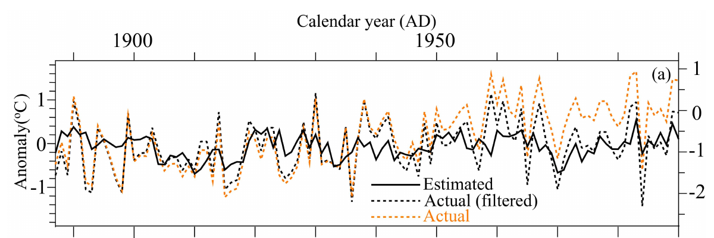

# 古気候学入門
年輪年代学のための補助教材・入門／作業版

## 古気候を調べる理由
古気候学は、過去の気温や水循環などの変動を、自然や人間が残した記録から調べる分野です。観測機器による記録の届かない時代を対象に、変化の大きさや速さ、地域差を検討します。過去の変化を知ることは、気候の仕組みを確かめ、近年の変化を長期的な文脈に置く助けになります。

## 直接観測と代替指標
過去の気温を温度計で直接測れないとき、気候の影響を受けた特徴を代替指標として使います。年輪幅、氷中の同位体比、堆積物に含まれる花粉は例です。いずれも気温や雨量そのものではありません。気候以外の要因、保存状態と測定方法を調べ、指標から気候量への関係を検討します。

## 読むときの基本
何を測ったか、いつの記録か、どの地域と季節を代表するか、どこまで推定できるかを区別しましょう。

<!-- pagebreak -->

# 過去の気候を復元する意義
## 短い観測記録の外側を見る
器械による気温や降水量の記録は貴重ですが、長い気候の歴史のうち一部に限られます。古い年輪や堆積物を調べれば、観測以前にも繰り返した変動や長く続いた干ばつなどを検討でき、近年の出来事がその地域の長期的な変動の中でどのような位置にあるかを考えられます。推定できる時間の細かさは資料ごとに異なるため、記録が捉えられない短い極端現象もあります。

## 気候の仕組みと影響を考える
季節・地域ごとの気候の変化を、海や大気の働き、火山活動などと照らし合わせることで、変化の仕組みに関する仮説を調べます。復元が気候モデルの計算と合うかを、使用データや誤差を確認しながら比較すれば、モデルの理解や改善にも役立ちます。

過去の水分条件と森林の成長、湖水位、水利用に関する資料を比べれば、水資源や生態系が変化にどう応答したかを考えられます。歴史資料と比べるときも、年代、地域、社会の制度などを吟味し、気候だけを唯一の原因としません。

## 将来と比べるときの注意
過去の一時代を、そのまま将来と同じ条件とは扱えません。温室効果ガス、火山活動、土地利用などの背景が異なるからです。対象の季節や地域、年代の不確かさ、復元できる変動、比較資料の独立性を確認し、複数の証拠を使います。

<!-- pagebreak -->

# 気候の記録を比べる
## 代表的な資料
年輪：幅・密度・化学組成など。年代照合できれば暦年単位の記録を得られますが、形成期と樹種・生育地の条件に左右されます。

氷床コア：氷の同位体や閉じ込められた空気など。記録の長さ・時間分解能・年代の確かさは深さや地点によって異なります。

湖・海底堆積物：花粉、微化石、化学成分など。堆積や生物による混合を考え、年代を複数の方法で制約します。

サンゴや洞窟生成物：成長層の化学組成など。記録の対象や時間分解能は試料と測定に依存します。

## 複数資料を使う
資料ごとに対象地域・季節・年代の不確かさが違います。異なる結果は単純な誤りとは限らず、それぞれが別の季節や過程を記録している可能性があります。同じ元データを使う二つの論文を、独立な二つの記録として数えないようにします。

<!-- pagebreak -->

# いつの記録か、何年分を区別できるか
## 年代モデル
堆積物なら、複数の深さで得た年代や層序をもとに、深さと年代の関係を推定します。各位置の年代には不確かさがあり、その大きさは記録の中で一定とは限りません。年輪では、複数の個体のパターンを照合し、暦年が分かる基準につないで年代を定めます。

## 三つの異なる問い
サンプリング間隔：何年分ごとに試料を測ったか。時間分解能：元の変化のうち、どの程度細かい変動まで区別できるか。年代の精度・不確かさ：各試料をいつのものと位置づけられるか。測定間隔が短くても、堆積時の混合などで細かな変動が平滑化されることがあります。

年輪を暦年で定められても、年輪幅が一年の毎日の気温を記録するわけではありません。樹木は形成期の気象や前年からの影響などに応答します。

<!-- pagebreak -->

# 年輪から気候を推定する
## 研究の流れ
問いと対象季節を決め、樹種・地点を選びます。年代を照合し、成長や樹齢に伴う傾向の処理を検討して年輪の系列を作ります。比較する気象観測の場所、期間、変数と単位も確かめます。

観測期間の一部で関係を求めることを較正、モデルの作成に使っていない情報で成績を調べることを検証と呼びます。対象季節やモデルを選ぶ過程に検証データを使うと、成績が楽観的になることがあります。時代を分けた検証と、別地域・別資料による比較の独立性も吟味します。

## 限界と不確実性
標準化の方法によって長周期の変化が失われることがあります。年輪と気温の関係が時間や場所で変わる場合もあります。復元結果には、対象地域・季節・期間、試料数、方法と不確実性を添え、観測値と推定値を区別します。

<!-- pagebreak -->

# 実例と歴史への応用
## 北東アジアの春
Ohyama ら（2013）は日本・韓国の5系列を用い、北緯35〜40度、東経125〜140度の陸域の3〜5月平均気温を1784〜1990年にわたり復元しました。1887〜1990年の較正では調整済み決定係数は0.194でした。前半と後半を入れ替える分割検証のCEは0.019と−0.040で、較正の値とは別です。

研究では観測気温の長周期成分を処理し、復元を年々〜数十年の変動の検討に用いました。長期的な温暖化傾向をそのまま復元できるという意味ではありません。[原著論文](https://doi.org/10.5194/cp-9-261-2013)

## 気候と歴史
寒冷な時期と社会の変化が重なっても、重なりだけでは因果関係を示せません。復元が示す地域・季節・年代の範囲を確認し、食料・水・制度や土地利用などを介した過程と別の説明を史料・考古資料と比べます。

<!-- pagebreak -->

# 観測値と推定値の図を読む

## 三つの線と二つの縦軸
黒の実線は推定値、黒の点線は長周期成分を処理した観測値で、どちらも左の縦軸を使います。橙の点線は処理前の観測値で、右の縦軸を使います。二つの軸の目盛りは異なるため、線の高さをそのまま比較しません。

1887〜1990年全期間を較正に使った図であり、この図自体は独立した検証結果ではありません。前後半を入れ替えた分割検証のCEは、前ページで扱った別の数値です。

出典：[Ohyama ら（2013）Fig. 3(a)から切り出し](https://doi.org/10.5194/cp-9-261-2013)／[CC BY 3.0](https://creativecommons.org/licenses/by/3.0/)

<!-- pagebreak -->

# 演習・参考資料
## 考えてみよう
ある湖の試料は10年ごとに測定されています。しかし堆積物が混合され、約50年の変動がなめらかになり、年代にも幅があります。10年ごとの測定値から、特定の一年の干ばつを確実に特定できるでしょうか。これは説明用の架空例です。

## 解説
できません。10年という測定間隔と、変動を区別できる時間分解能、年代の不確かさは別です。混合による平滑化と年代幅を考え、年輪など、異なる性質の資料と比べます。ただし年輪も形成期に感度を持つことや他の成長要因を確認します。

## さらに調べる
[NOAA：年輪データ](https://www.ncei.noaa.gov/products/paleoclimatology/tree-ring)／[NOAA：代替指標](https://www.ncei.noaa.gov/news/what-are-proxy-data)／[IPCC：気候変化の証拠](https://www.ipcc.ch/report/ar6/wg1/chapter/chapter-2/)／[Ohyama ら（2013）](https://cp.copernicus.org/articles/9/261/2013/)

資料を読む際は、測定値、著者の復元、紹介文の説明を区別し、方法と限界まで確認しましょう。
