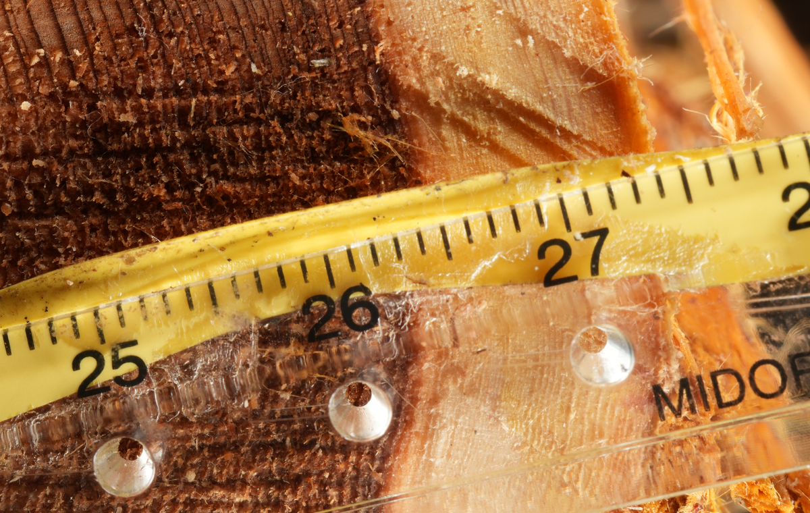
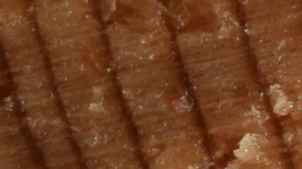
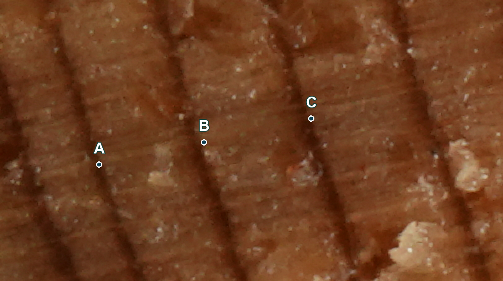

# デジタル画像と年輪計測

年輪年代学入門の補助教材。第4回スライド13〜17に対応。要求精度、画像の細かさ、計測データの関係を、コウヤマキの実資料で学びます。

## 画素は画像を構成する小さな要素

デジタル写真は、色や明るさの値を持つ画素が縦横に並んだものです。写真全体の画素数が多くても、広い範囲を写していれば、年輪の細部まで読み取れるとは限りません。

木曽のコウヤマキの木口面。尺度も写し、画素で測った距離を実際の長さへ対応させます。写真は表示用に縮小しています。

## mm/pix：1画素が表す試料上の長さ

0.005 mm/pixなら、1画素が0.005 mmに相当します。値が小さいほど、同じ長さをより細かく記録できます。本教材では画素の細かさをmm/pixで表します。

<!-- pagebreak -->

# 校正と0.01 mmの要求精度

## 尺度で画素と長さを結びつける

年輪面と同じ平面に置いた尺度で、既知の区間を選びます。その区間の長さを画素数で割ると、1画素が表す長さを求められます。

校正値（mm/pix）＝ 既知の長さ（mm）÷ 画素数（pix）

例：10 mmが2000画素なら、10 ÷ 2000＝0.005 mm/pix。年輪界の間が60画素なら、60 × 0.005＝0.30 mmです。この数値例は計算練習用です。

## 画像の条件と、実際の精度を区別する

年輪幅の要求精度は0.01 mmです。撮像では画素間隔を0.01 mm/pix以下とする条件を確認します。ただし、この条件を満たすだけで測定精度が保証されるわけではありません。ピント、試料面の処理、撮影の歪み、尺度の置き方、境界の判読も関わります。

今回の元画像の校正記録は約0.0058 mm/pixです。これは画素間隔を表す値であり、「0.0058 mmの精度で測定できた」という意味ではありません。

## 確認問題

同じ画素数のカメラで、試料の2倍の幅を写したら、mm/pixはどう変わるでしょうか。

解説：ほかの条件が同じなら、1画素が表す長さも2倍になり、画像は粗くなります。カメラの総画素数だけで計測への適否を判断できない理由です。

<!-- pagebreak -->

# 表示を拡大することと、情報の量

同じ試料範囲を、同じ大きさで表示した比較です。右の画像は縦横の画素数を1/4に減らしてから拡大表示しています。

左：600×336画素、約0.0058 mm/pix。右：150×84画素、約0.0232 mm/pix。右は0.01 mm/pix以下という条件を満たしません。

## 拡大表示と画素数の変更

画面上のズームは、見せる大きさを変えます。元の情報が増えるわけではありません。画素数を減らす縮小では細部の情報が失われ、再び大きく表示しても取り戻せません。

## 切り抜きと縮小の違い

元の画素をそのまま残す切り抜きでは、写る範囲は狭くなりますが、mm/pixは変わりません。画素数を変える縮小ではmm/pixも変わるため、計測用の校正値を更新します。

## 元画像を残す

計測用の元画像を保存し、スライド用の縮小画像は別に作ります。JPEGの繰り返し保存や強い圧縮、過度の補正は細部を変える可能性があります。画像を加工した場合は、内容と版を記録します。

<!-- pagebreak -->

# 写真・POS・rwlを結びつける

写真上のA・B・Cは、CooRecorderに保存された3点を重ねたものです。rwlの並びに合わせて表示しています。図の記号は暦年ではありません。

| 区間 | rwlの値 | 年輪幅 |
| --- | --- | --- |
| A–B | 74 | 0.74 mm |
| B–C | 76 | 0.76 mm |

このrwlでは、値の単位は0.01 mmです。74 × 0.01＝0.74 mmと読みます。保存する刻みと、測定の正確さは別です。POSの座標にさらに小さな桁があっても、その桁まで精度が保証されたことにはなりません。

POSは写真上の測定位置と校正の情報、rwlは年輪幅系列を確かめるために使います。測線の切り替えや並び順も確認します。この分割ファイルの1、10などの番号を、西暦として読まないでください。

出典：[米延ほか（2026）コウヤマキ研究](https://doi.org/10.1016/j.dendro.2026.126565)、[研究データ](https://doi.org/10.50974/0002007852)。写真・測定記録は研究グループの資料。画像20ko478・MO103934と対応するPOS/rwlを参照。

操作の参考：[ImageJ：尺度の設定](https://imagej.net/ij/docs/menus/analyze.html#scale)、[CooRecorder公式案内](https://www.cybis.se/forfun/dendro/)。本教材のためにソフトウェアを購入・操作する必要はありません。
