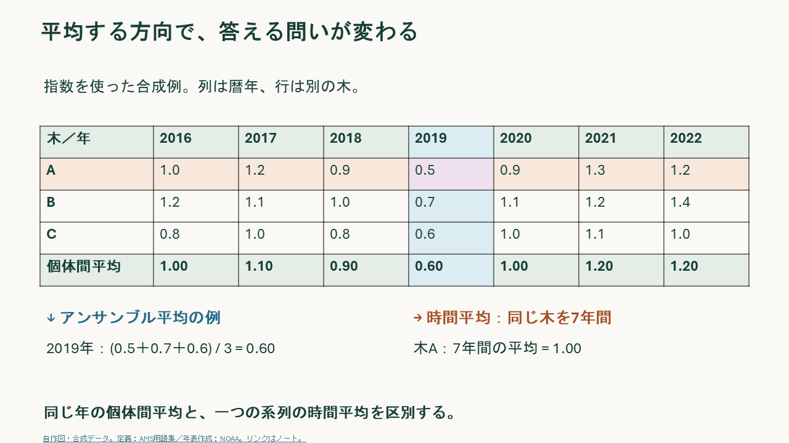
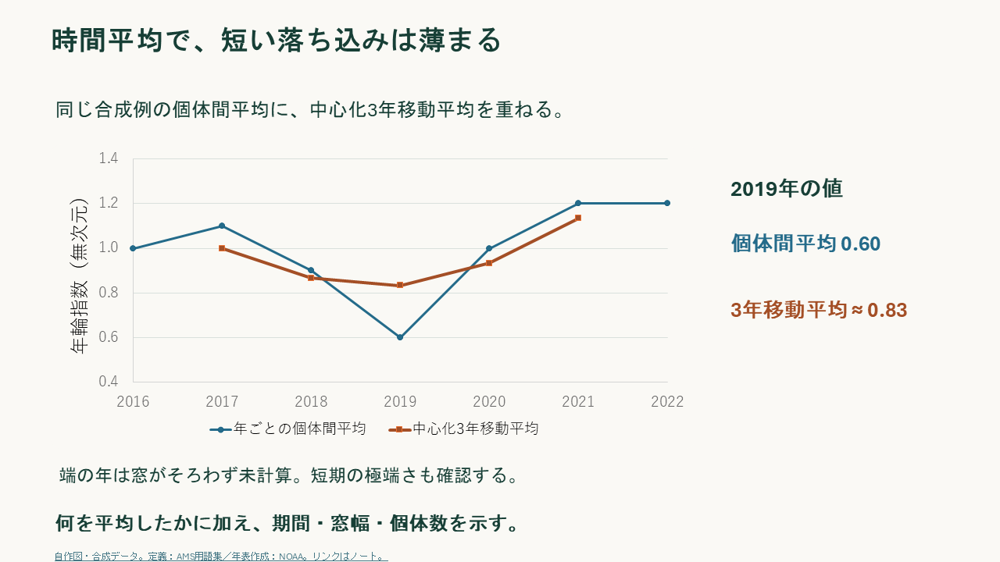

# アンサンブル平均と時間平均

第4回補足。年表を作るときと、年表の長期変動を見るときでは、平均する方向が異なります。ここでは標準化済みの年輪指数を想定した合成データを使います。実測値や特定の気候イベントの記録ではありません。

縦方向：同じ2019年の木A・B・Cを平均すると、(0.5 + 0.7 + 0.6) / 3 = 0.60。同じ時点のメンバー間の平均として、アンサンブル平均の考え方を理解する例になります。

横方向：木Aの2016～2022年を平均すると、7.0 / 7 = 1.00。これは一つの系列の指定期間の時間平均です。期間と対象を必ず示します。

年輪研究では、クロスデーティングで暦年をそろえ、目的に応じて標準化し、同じ木の複数試料を先に集約します。木は同じ環境を共有するため、独立で同一の分布に従う反復であるとは限りません。個体間平均を、厳密な確率モデルのアンサンブル期待値と無条件に同一視しないようにします。

<!-- pagebreak -->

# 時間方向の平均で、短期変動が薄まる

青線は各年の個体間平均です。2019年の0.60という落ち込みを残します。オレンジ線はその系列の中心化3年移動平均です。2019年の位置に、2018～2020年の平均を置きます。

m_3(2019) = (0.90 + 0.60 + 1.00) / 3 ≈ 0.83

移動平均は時間平均の一種で、窓をずらしながら計算します。長めの変動を読みやすくしますが、短期の極端さを弱め、急変の前後にも影響を広げます。この図では完全な3年窓のない2016年・2022年は未計算です。窓の重複によって隣接する移動平均値も相関しやすくなります。

問い：2019年の落ち込みの強さを比べたいとき、どちらの線を確認すべきでしょうか。答え：元の年ごとの系列を確認します。移動平均も目的に応じて併記し、窓幅と端の処理を示します。合成例なので、落ち込みの原因を干ばつなどと断定することはできません。

<!-- pagebreak -->

# 数式と、平均の限界

## 平均の添字を区別する

x_i(t)を暦年tの個体iの指数とします。年ごとの利用可能な個体数をn_tとすると、単純な個体間平均は m_E(t) = [Σ_i x_i(t)] / n_t です。足し合わせるのはその年に値のある個体です。欠測を0に置き換えません。実際の年表作成では頑健な平均なども使います。

個体iの等間隔のT時点の時間平均は m_T(i) = [Σ_t x_i(t)] / T です。和を取る方向が違います。確率モデルにおけるアンサンブル平均は期待値E[X(t)]で、有限個のメンバーから計算する平均は、その推定・近似として考えます。

## どの程度、ばらつきが減るか

共通信号に独立・平均0の誤差が加わり、各誤差の分散がσ²である単純なモデルでは、n個体の平均の誤差分散はσ²/nです。誤差どうしが共通の相関ρを持つモデルでは、σ²[1 + (n − 1)ρ]/nになります。個体数だけを増やしても、共有する偏りや強い相関は解消しません。実データでは個体差・不均一な相関・試料選択の偏りも検討します。

## 時間平均とアンサンブル平均を置き換える条件

両者が一致するという仮定にはエルゴード性などの条件が関わります。定常性だけから一致を保証することもできません。気候にトレンドやレジームシフトがあると、期間の取り方で時間平均は変わります。入門段階では、何を・いつ・何個・どの方法で平均したかを説明できれば十分です。

第7回との接続：気温の期間平均は時間方向の集約です。気候モデルのアンサンブル平均では、メンバーは同じ対象時刻を表す複数の計算結果です。観測地点間の平均は空間平均で、これも時間平均と区別します。

## 出典と発展学習

- [AMS：アンサンブル平均](https://glossary.ametsoc.org/wiki/ensemble-average/)・[時間平均](https://glossary.ametsoc.org/wiki/time-average/)・[エルゴード条件](https://glossary.ametsoc.org/wiki/ergodic-condition/)
- [NOAA：年輪データと年表作成の説明](https://www.ncei.noaa.gov/pub/data/paleo/treering/treeinfo.pdf)
- 図と数値はこの教材のために新規作成した合成例です。原資料の図の転載ではありません。
