# 樹木の成長様式と成長曲線

第2回補足。針葉樹の一般的な樹形から、成長を量で表すモデルへ進みます。本資料の図・数値は説明用に新規作成したもので、特定樹種の実測値ではありません。

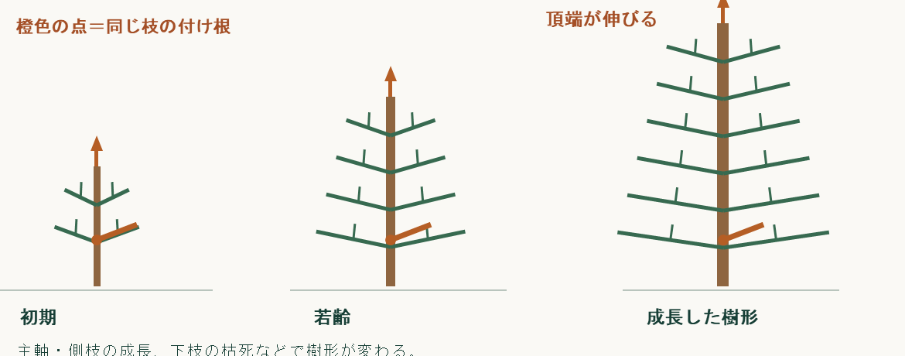

多くの針葉樹では主軸が持続する単軸分枝が見られます。主軸や側枝の伸長と、形成層による肥大成長を区別します。頂芽優勢は樹形に関わりますが、枝の角度・伸長・枯死や、光・競争・損傷も樹形を変えます。常に整った円すい形になるわけではありません。

マツ類などには前年の芽の中に次のシュートの構造が用意される成長がありますが、同じ季節の再伸長もありえます。枝の段数を無条件に樹齢とみなせません。根も先端付近で伸び、木本の根には肥大成長が見られますが、根系の形は樹種・土壌・水分などで変わります。

年内の芽の伸長、形成層の分裂、細胞の拡大、壁形成は同時に始まり終わるとは限りません。季節内の成長過程と、数十年間の大きさの変化は、時間の尺度を分けて考えます。

<!-- pagebreak -->

# 代表的な決定論的成長曲線

決定論的モデルでは、時間と係数を指定すると予測値が一意に決まります。確率変動や観測誤差をモデルに加えることもできます。滑らかな決定論的曲線だけで実際の年変動すべてを説明するわけではありません。

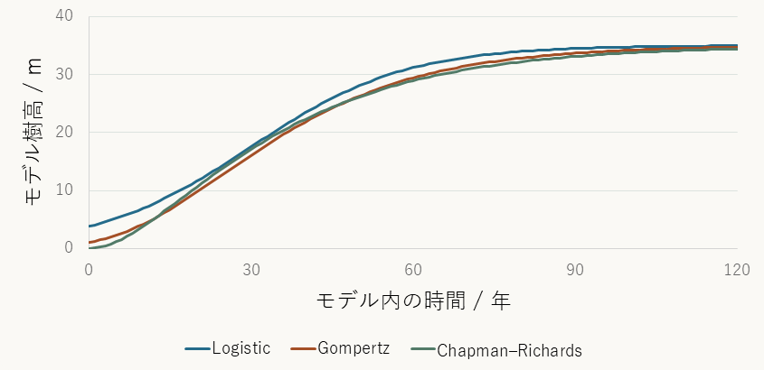

## ロジスティック曲線

![H(t)=K/[1+exp{-r(t-t0)}]](assets/logistic.png)

## ゴンペルツ曲線

![H(t)=K exp[-exp{-r(t-t0)}]](assets/gompertz.png)

## Chapman–Richards曲線の一形式

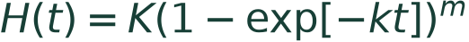

Hは樹高、tは時間、Kはこのモデルでの漸近値です。r・kは時間の逆数の単位、t0は時間、mは無次元の形状係数です。図はK=35 m、ロジスティックr=0.07・t0=30、ゴンペルツr=0.05・t0=25、Chapman–Richards k=0.04・m=2。時間単位は年です。係数は任意で、樹種に当てはめた値ではありません。初期値が異なり、モデル内のt=0を発芽時と同一視しません。

この形式ではK>0、r・k>0とします。Chapman–Richardsはt≥0で用い、m>1のときS字型になります。変曲点の樹高はロジスティックでK/2、ゴンペルツでK/eです。モデル名が同じでも、係数や式の表し方を確認してください。

<!-- pagebreak -->

# 大きさ・絶対成長速度・相対成長速度

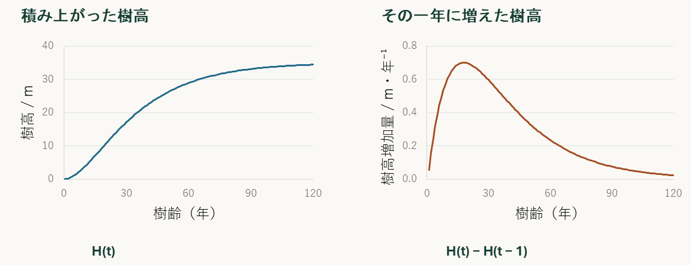

年ごとの増加量はΔH(t)=H(t)−H(t−1)。1年分の差なので単位はmで、1年で割った平均速度をm/年で表せます。連続時間では次の微分で表します。

絶対成長速度AGRの単位はm/年、相対成長速度RGRは年⁻¹です。後者はその時点の大きさ当たりの増加速度で、H>0の範囲で定義します。年輪の標準化指数とは異なる量です。

ロジスティックとゴンペルツでは、微分を次の形に書けます。lnは自然対数です。

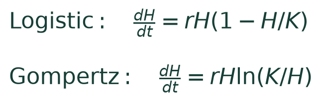

本資料のChapman–Richards形式の微分は次のとおりです。

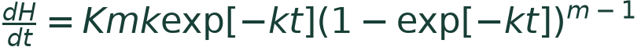

上限に近づいて樹高増加量が小さくなっても、直径・材積・質量の増加が同じように小さくなるとは限りません。係数、初期条件、対象期間、残差を確認し、被陰・成長解放・攪乱のある系列への外挿を慎重に行います。

<!-- pagebreak -->

# 年輪幅と断面積増加量

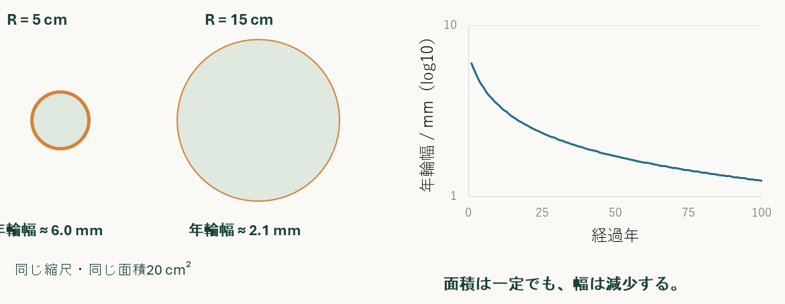

樹皮を除く円形・同心の断面を仮定し、前年の半径をR、年輪幅をwとします。断面積増加量BAIは円環の面積です。

![BAI=pi[(R+w)^2-R^2]=pi(2Rw+w^2)](assets/bai.png)

BAIを一定値Bとして幅を解くと、次のようになります。近似式はwがRに比べて十分小さい場合です。

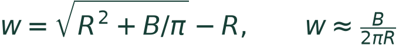

B=20 cm²、R=5 cmでw≈6.01 mm、R=15 cmでw≈2.11 mmです。図の経時変化もBを一定にしたモデルで、縦軸はlog10目盛です。一定の面積増加でも幅は狭くなります。実際のBAIは一定とは限らず、BAIへの変換だけで樹齢・大きさの影響がすべて除かれるわけではありません。

BAIは断面の量です。幹全体の材積増加、木全体の質量増加とは区別します。偏心、不連続年輪、髄の欠損、採取高を確認し、単一の測線からの推定の限界を記録します。第4回の標準化につながる前提です。

<!-- pagebreak -->

# アロメトリーと時間変化をつなぐ

成長曲線は時間tと大きさの関係です。アロメトリーは、直径Dと質量Mなど、異なる量どうしの関係を表します。基本的なべき乗モデルはM=aD^bです。a・bは対象と単位に依存し、bをすべての樹種に共通の値とはしません。

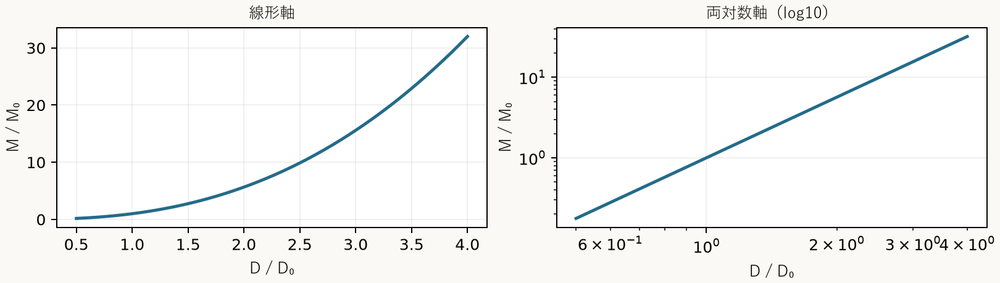

図は説明用のM/M0=(D/D0)^2.5で、係数を当てはめたものではありません。基準量D0・M0で無次元化すると、対数表示は次式です。両対数図の傾きが指数bに対応します。

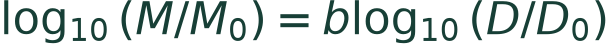

同じ個体の時間変化にも同じ関係が成り立ち、a・bが一定と仮定できるなら、連鎖律から次式が得られます。

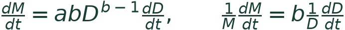

例：b=2.5で直径が2倍、直径増加速度が半分なら、質量増加速度の比は2^1.5×0.5≈1.41です。幅・直径の増加速度の低下だけから、質量増加速度の低下は決まりません。ただし、異なる個体間で得た回帰式を、一個体の時間変化に適用できるとは限りません。質量の範囲（幹・地上部・全木）、樹種、直径範囲、係数の不確かさも確認します。

<!-- pagebreak -->

# 出典と発展学習

- Avery & Burkhart (1994). Forest Measurements, 4th ed., pp. 303–305（所蔵書籍）。
- [Meinzerほか編 (2011), Size- and Age-Related Changes in Tree Structure and Function](https://doi.org/10.1007/978-94-007-1242-3)、第4・6章（所蔵書籍）。
- [Pommerening & Muszta (2015)：成長モデル](https://doi.org/10.1186/s40663-015-0029-4)・[Biondi & Qeadan (2008)：年輪幅と面積](https://research.fs.usda.gov/treesearch/32501)
- [Chojnackyほか (2014)：バイオマス推定式](https://doi.org/10.1093/forestry/cpt053)・[Stephensonほか (2014)：大きさと質量増加](https://doi.org/10.1038/nature12914)
- [Iowa State：樹木の成長様式](https://naturalresources.extension.iastate.edu/forestry/tree_biology/101.html)・[Punches (2004)：樹木の成長と木材](https://www.cof.orst.edu/cof/fs/kpuettmann/FS%20533/PNW576.pdf)
