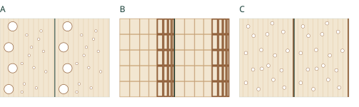
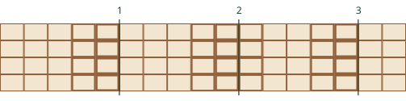

# Lesson 2 Tree growth, wood anatomy and ring structure

90 minutes. Corresponds to L02_S01–L02_S30. Use the questions for individual recording and paired discussion.

## Key ideas

Primary growth extends shoots and roots. Secondary growth increases thickness through lateral meristems. The timing of the two can overlap.

The vascular cambium produces secondary xylem inward and secondary phloem outward. The whole bark does not originate from this cambium.

Mature tracheids and vessel elements are usually dead, but sapwood includes living parenchyma. A heartwood–sapwood colour change is not a growth-ring boundary.

An annual ring is a yearly increment of wood. A boundary separates increments; the dark band is not the entire ring.

## Directions and planes

| Plane | Directions and observations |
| --- | --- |
| Transverse | R–T plane, perpendicular to L. Follow ring widths radially. |
| Radial | L–R plane. Compare rays and longitudinal cells. |
| Tangential | L–T plane. Examine ray height and width. |

L = longitudinal; R = radial; T = tangential. Rays extend principally in R.

<!-- pagebreak -->

# Observation A Three schematic samples

Original simplified transverse schematics, not micrographs. They cannot identify species. Pith-to-bark direction runs left to right.

## Questions

Assign A, B and C to softwood, ring-porous or diffuse-porous wood. Mark boundary candidates and support them with pore distribution and wall changes.

## A  Observations / interpretation / further information

<!-- writing-space -->

## B  Observations / interpretation / further information

<!-- writing-space -->

## C  Observations / interpretation / further information

<!-- writing-space -->

## Check real specimens

Use FFPRI wood databases to compare sugi, chestnut or konara oak, and beech. Check plane, magnification or scale, and specimen ID. Record one difference from the schematic.

[FFPRI 木材データベースへの入口 / Database entry](https://www.ffpri.go.jp/database.html)

<!-- pagebreak -->

# Observation B Boundaries and ring counts

Which of candidates 1, 2 and 3 delimit years? Examine changes and reversals in lumen size and wall thickness. This is a schematic teaching example.

## Interpretation and evidence. Which other radius, sample or method would help?

<!-- writing-space -->

## Interpret tree age

A fictional core taken at 1.3 m has bark but no pith. It contains 42 visible rings. Does this establish 42 years since germination? List three pieces of missing information.

<!-- writing-space -->

A locally absent ring may exist on another radius of the same tree. Check it, and false-ring candidates, using other radii and trees.

<!-- pagebreak -->

# Terms and further study

| Japanese / English | Brief explanation |
| --- | --- |
| 形成層（vascular cambium） | Meristem producing xylem and phloem. |
| 仮道管（tracheid） | Elongated cell involved in conduction and support. |
| 道管（vessel） | Water-conducting chain of vessel elements. |
| 放射組織（ray） | Tissue extending principally radially. |
| 辺材／心材（sapwood / heartwood） | Outer functional wood and inner transformed wood. |
| 早材／晩材（earlywood / latewood） | Wood formed earlier / later within an increment. |
| 年輪界（tree-ring boundary） | Boundary between annual increments. |
| 偽年輪（false ring） | A boundary-like feature within an increment. |
| 局所的欠損輪（locally absent ring） | An annual increment absent from part of the stem. |

## Linked resources

[R18 Wood Handbook, Chapter 3](https://research.fs.usda.gov/fpl/wood-handbook)　USDA Forest Products Laboratory

[R19 Ring-growth anomalies: real examples](https://www.ltrr.arizona.edu/skeletonplot/ringanomalies.htm)　University of Arizona LTRR

[R09 Glossary of Dendrochronology](https://www.wsl.ch/en/services-produkte/glossary-of-dendrochronology/)　WSL

[R17 Stems and primary / secondary growth](https://openstax.org/books/biology-2e/pages/30-2-stems)　OpenStax Biology 2e

[R20 How do you measure the age of a tree?](https://www.nist.gov/how-do-you-measure-it/how-do-you-measure-age-tree)　NIST

Review: write one sentence supporting each A–C classification. Prepare for Lesson 3 with glossary T31–T38.