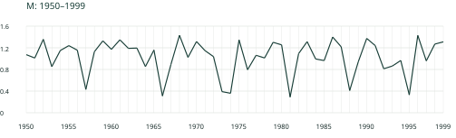
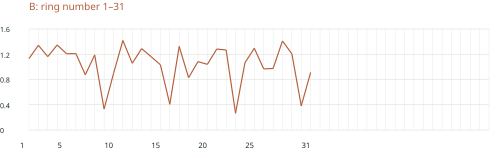
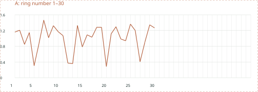

# Reading Environment and History through Tree Rings

## Lesson 3 Principles of dendrochronology · 90 minutes

Crossdating tests dates for individual rings by matching shared patterns among series. Distinguish this from simply counting rings.

## Interpreting shared variation

Growth reflects age and size, climate, competition and disturbance. Limiting factors depend on species, site and period.

Replication can involve different radii, trees or sites. Two radii from each of two trees yield four samples, not four independent trees.

Uniformitarianism is a starting point; growth responses need not remain constant. Check dating and environmental interpretation separately.

## Matching procedure

1. Check boundaries and ring numbers.

2. Compare patterns with the reference using equal annual spacing.

3. Compare alternative placements and investigate mismatches.

4. Check anatomy, other radii, other trees and statistical evidence.

5. Record reasoning and unresolved questions.

All exercise data are synthetic arbitrary units, not empirical ring widths. Short sequences around 30 rings practise a procedure and do not define dating criteria.

<!-- pagebreak -->

# Exercise A A complete 30-ring sequence

Place A within reference M, 1950–1999, and propose first and last years. Both plots use the same annual spacing. Cut-out strips are on page 6.

## Proposed first / last year:

<!-- writing-space -->

Record at least three matching features. Distinguish ring numbers from candidate calendar years.

| Ring number in A | Candidate year in M | Matching feature |
| --- | --- | --- |
|  |  |  |
|  |  |  |
|  |  |  |

Where does an alternative placement fail?

<!-- writing-space -->

<!-- pagebreak -->

# Exercise B A shift within 31 observed rings

Compare early and late segments. Can one constant shift align the whole sequence? Identify where to re-examine the specimen before deciding the cause.

## Candidate start for the early segment / later shift:

<!-- writing-space -->

## Ring positions surrounding the shift and possible causes:

<!-- writing-space -->

What evidence could distinguish a locally absent increment from a missed boundary?

<!-- writing-space -->

<!-- pagebreak -->

# Verification and links to the final report

Correlation helps narrow candidate placements. Interpretation depends on overlap, preprocessing, autocorrelation and search range. One high coefficient is insufficient.

Agreement with a reference already containing the unknown is not an independent test. Use a reference excluding it or other samples.

An inferred missing increment is not an observed width of zero. Preserve original data and record missing positions separately.

## Record your decision

Conclusion and supporting evidence:

<!-- writing-space -->

Mismatches or remaining uncertainty:

<!-- writing-space -->

Additional specimens, observations or analyses needed:

<!-- writing-space -->

## Preparing the final report

For a research plan or review, distinguish the question, evidence and method, results or expected results, and limitations or alternatives. The syllabus specifies 2–4 A4 pages, optional figures, and at least three references; deadlines and marking details will be announced.

<!-- pagebreak -->

# Terms and linked resources

| Japanese / English | Brief explanation |
| --- | --- |
| 制限因子（limiting factor） | An environmental or physiological constraint on growth. |
| 反復試料（replication） | Checking reproducibility across radii or trees. |
| クロスデーティング（crossdating） | Verifying ring dates through shared patterns. |
| 標準年輪曲線（reference chronology） | A securely dated series used as a reference. |
| 浮動年輪曲線（floating chronology） | An internally dated sequence not anchored to calendar years. |
| スケルトンプロット（skeleton plot） | Marks representing relatively narrow or distinctive rings. |
| 重複年数（overlap length） | Number of years shared by two sequences. |
| 局所的欠損輪（locally absent ring） | An annual increment absent from part of the stem. |

[R21 Instructional crossdating exercises](https://ltrr.arizona.edu/exercises)

[R22 Making skeleton plots](https://www.ltrr.arizona.edu/skeletonplot/plotting.htm)

[R23 The dated master chronology](https://www.ltrr.arizona.edu/skeletonplot/masterchronology.htm)

[R24 Finding the dates](https://www.ltrr.arizona.edu/skeletonplot/findingdates.htm)

[R25 Absent and false rings](https://www.ltrr.arizona.edu/skeletonplot/absentfalse.htm)

[R08 International Tree-Ring Data Bank](https://www.ncei.noaa.gov/products/paleoclimatology/tree-ring)

Search terms: crossdating / marker year / skeleton plot / missing ring / reference chronology.

<!-- pagebreak -->

# Cut-out curve strips

Cut around A and B. Move each strip below M on pages 2–3, keeping the same horizontal step. Match several features rather than just endpoints.

<!-- writing-space -->

<!-- writing-space -->

## Optional spreadsheet activity

Create an XY scatter plot with straight lines from the supplied CSV columns. A and B use ring numbers; M uses calendar years. In a working copy, add candidate start year + ring number − 1. Keep missing-ring hypotheses in separate columns and preserve source CSV files.