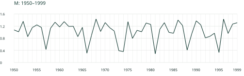
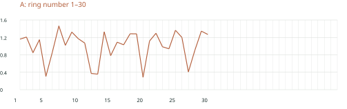
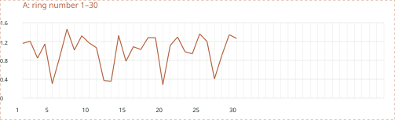
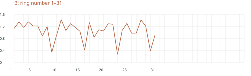
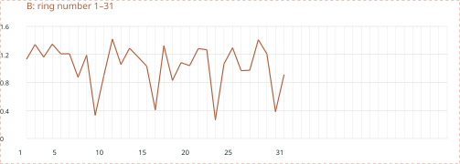

# 樹木年輪で読む環境と歴史

## 第3回 年輪年代学の原理｜90分

クロスデーティング（crossdating）は、複数の年輪系列に共通する変動を照合し、各年輪の年代を検証する方法。単純な輪数の計数とは区別する。

## 共通変動を読む前提

成長には、加齢・幹の大きさ、気候、競争や攪乱などが重なって現れる。制限因子（limiting factor）が何かは、樹種・立地・時期によって変わる。

反復試料（replication）は、同じ木の複数方向、別個体、別地点を区別する。木2個体から2方向ずつ採れば4試料だが、独立した4個体ではない。

斉一原理（uniformitarianism）を出発点にしても、成長と環境の応答関係が過去から一定とは限らない。年代判定と環境解釈は別に検証する。

## 照合の手順

1. 試料の境界・輪番号を確認する。

2. 特徴の並びを、同じ一年一目盛りで基準と比較する。

3. 複数の候補位置と、不一致の箇所を調べる。

4. 組織・別方向・別個体・統計を組み合わせて検証する。

5. 判定根拠と未解決点を記録する。

本演習はすべて合成データ。任意単位の値であり、実測年輪幅ではない。30輪程度の短い系列は練習用で、実試料の確定基準ではない。

<!-- pagebreak -->

# 演習A 欠損のない30輪

Mの1950〜1999年へAの30輪を重ね、最初・最後の年を推定する。次のグラフは同じ一目盛幅。切り離し用カードは6ページ。

## 開始年／終了年：

<!-- writing-space -->

対応する特徴を3か所以上記録する。輪番号と暦年候補を区別する。

| Aの輪番号 | Mの暦年候補 | 一致する特徴 |
| --- | --- | --- |
|  |  |  |
|  |  |  |
|  |  |  |

別の配置では、どこが合わないか。

<!-- writing-space -->

<!-- pagebreak -->

# 演習B 途中でずれる31輪

前半と後半を区間ごとに照合する。一つの平行移動で全体が合うか。原因を決めつけず、再観察する位置を記す。

## 前半が合う開始年候補／後半のずれ：

<!-- writing-space -->

## ずれの前後の輪番号と、原因候補：

<!-- writing-space -->

何を調べれば「局所的欠損」と「読み落とし」を区別できるか。

<!-- writing-space -->

<!-- pagebreak -->

# 検証とレポートへの接続

相関（correlation）は候補を絞る手がかり。重複長、前処理、自己相関、候補を探した範囲によって解釈が変わる。高い値一つで年代を確定しない。

未知試料を基準曲線に含めたうえで、その基準との一致を独立な検証としない。未知試料を除いた基準や、別の試料で確かめる。

欠損位置を見つけても、観察幅がゼロだったという測定値を作らない。原データと解釈を分け、欠損位置は空欄などで記録する。

## 自分の判定を記録する

結論と、その根拠：

<!-- writing-space -->

不一致や、まだ確かでない点：

<!-- writing-space -->

追加で必要な試料・観察・解析：

<!-- writing-space -->

## 最終レポートへの手がかり

研究計画または文献レビューをまとめるときも、「問い → 資料・方法 → 結果／予想される結果 → 限界・代替解釈」を分ける。シラバスではA4 2〜4枚・図表可・引用3件以上。提出期限と配点は授業で案内する。

<!-- pagebreak -->

# 日英用語と参考リンク

| 用語 | 簡単な解説 |
| --- | --- |
| 制限因子（limiting factor） | 成長を制限する環境・生理要因。 |
| 反復試料（replication） | 複数の方向・個体などで再現を確認すること。 |
| クロスデーティング（crossdating） | 共通変動を照合し年輪の年代を検証すること。 |
| 標準年輪曲線（reference chronology） | 照合の基準となる、年代が確かな系列。 |
| 浮動年輪曲線（floating chronology） | 内部の相対年代が決まっても暦年未確定の系列。 |
| スケルトンプロット（skeleton plot） | 相対的に狭い輪などを印で示す図。 |
| 重複年数（overlap length） | 二つの系列が重なる年数。 |
| 局所的欠損輪（locally absent ring） | 幹の一部で形成されない年輪。 |

[R21 クロスデーティングの教材](https://ltrr.arizona.edu/exercises)

[R22 スケルトンプロットの作り方](https://www.ltrr.arizona.edu/skeletonplot/plotting.htm)

[R23 標準年輪曲線の意味](https://www.ltrr.arizona.edu/skeletonplot/masterchronology.htm)

[R24 照合で年代を割り当てる](https://www.ltrr.arizona.edu/skeletonplot/findingdates.htm)

[R25 欠損輪・偽年輪の照合](https://www.ltrr.arizona.edu/skeletonplot/absentfalse.htm)

[R08 国際年輪データバンク](https://www.ncei.noaa.gov/products/paleoclimatology/tree-ring)

英語の検索語：crossdating / marker year / skeleton plot / missing ring / reference chronology。

<!-- pagebreak -->

# 切り離し用の曲線カード

A・Bを枠の外で切り離し、2・3ページの基準Mの下で左右に動かす。横方向の一目盛幅を保ち、端ではなく複数の特徴を合わせる。

<!-- writing-space -->

<!-- writing-space -->

## 表計算でも試す場合

配布CSVの一列目をX、二列目をYとし、直線付き散布図を作る。A・Bには輪番号、Mには暦年が入っている。作業用に「開始年候補＋輪番号−1」の列を追加し、欠損の仮説は別列で残す。元CSVを上書きしない。