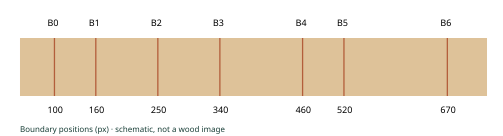

# Reading Environment and History through Tree Rings

## Lesson 4 Sampling, measurement and ring-width series · 90 minutes

Plan sampling, preserve specimens and records, observe and measure boundaries, verify dating, then detrend and build a chronology. Return to the wood and records when a mismatch appears.

## Sampling and records

Choose species, sites, trees and spatial coverage for the question. Tree and radius counts depend on the material and purpose.

Link site, tree, specimen and path IDs to collection date, position, species, pith, bark, losses, photographs and processing conditions.

Preserve orientation and fragment order. Material such as waterlogged wood needs suitable conservation.

## Mini exercise: moisture variability in a forest with ridges and valleys

Sites, trees and radii to sample, with reasons:

<!-- writing-space -->

Metadata to retain:

<!-- writing-space -->

A limitation arising from the areas not sampled:

<!-- writing-space -->

All numerical data and diagrams in this lesson are synthetic teaching examples, not empirical observations.

<!-- pagebreak -->

# Exercise A From boundary positions to widths

A known 10 mm spans 600 px. Boundary positions are 100, 160, 250, 340, 460, 520 and 670 px, increasing from inner to outer wood.

## Spatial scale: 600 ÷ 10 = ______ px/mm

| Ring | Boundaries | Difference (px) | Width (mm) |
| --- | --- | --- | --- |
| 1 | B0–B1 |  |  |
| 2 | B1–B2 |  |  |
| 3 | B2–B3 |  |  |
| 4 | B3–B4 |  |  |
| 5 | B4–B5 |  |  |
| 6 | B5–B6 |  |  |

Width (mm) = successive boundary separation (px) ÷ spatial scale (px/mm).

Sum of six widths: ________ mm / Endpoint distance: (670 − 100) ÷ scale = ________ mm

Why can a matching total fail to prove correct boundary identification?

<!-- writing-space -->

Check the scale in the specimen plane and account for resizing or distortion. Pixel count and displayed decimals alone do not establish accuracy.

<!-- pagebreak -->

# Quality control and dating records

Check units, precision, orientation, duplicate or missing rows, extremes and jumps. Investigate flagged values in the image and specimen before revising them.

## Specimen / path / image file:

<!-- writing-space -->

## Ring or boundary position to inspect:

<!-- writing-space -->

## Observed evidence:

<!-- writing-space -->

## Possible causes and additional evidence needed:

<!-- writing-space -->

## Any revision, its reason, operator and date:

<!-- writing-space -->

Distinguish ring numbers from calendar years. Investigate local absences, false rings and missed boundaries using anatomy and independent comparisons. Preserve observations and record dating hypotheses separately.

<!-- pagebreak -->

# What does standardization retain?

In this exercise, a ring-width index is width divided by a supplied growth-curve value. Both inputs simulate mm; the ratio is dimensionless. Real analyses choose detrending methods for their question.

The comparison uses a centred five-year mean, with available years at the edges. It demonstrates sensitivity rather than a recommended setting; a flexible reference can remove longer-term variation.

How could the information you need to retain depend on the research question?

<!-- writing-space -->

<!-- pagebreak -->

# Exercise B Build indices and a chronology

Open L04_B_widths_and_supplied_curves.csv. A contains years, B/C the width/curve of A, D/E those of B, and F/G those of C. Add indices in H:J, their available-value mean in K and tree count in L.

H2 = IF(ISNUMBER(B2), B2/C2, "") ／ I2 = IF(ISNUMBER(D2), D2/E2, "") ／ J2 = IF(ISNUMBER(F2), F2/G2, "")

K2 = AVERAGE(H2:J2) ／ L2 = COUNT(H2:J2)

Fill down from row 2 through row 37. Preserve blanks. The excerpt below also permits calculation without a computer. Divide width by the supplied curve.

| Year | Tree | Width mm | Curve mm | Index |
| --- | --- | --- | --- | --- |
| 1998 | A | 2.26560 | 1.88800 |  |
| 1998 | B | 1.92698 | 1.60582 |  |
| 1998 | C | 1.09175 | 1.21306 |  |
| 1999 | A | 1.65469 | 1.83854 |  |
| 1999 | B | 1.24045 | 1.55056 |  |
| 1999 | C | 1.18460 | 1.18460 |  |
| 2000 | A | 1.96986 | 1.79078 |  |
| 2000 | B | 1.94705 | 1.49773 |  |
| 2000 | C | — | — |  |

| Year | Mean index | Trees n |
| --- | --- | --- |
| 1998 |  |  |
| 1999 |  |  |
| 2000 |  |  |

What changes if C in 2000 becomes zero? What further checks would you want where fewer trees are available?

<!-- pagebreak -->

# Terms and linked resources

| Japanese / English | Brief explanation |
| --- | --- |
| 成長錐試料（increment core） | A cylindrical radial wood sample. |
| メタデータ（metadata） | Information describing specimens and processing. |
| 測線（measurement path） | The path used to measure widths. |
| 空間較正（spatial calibration） | Converting pixel distance to physical length. |
| 品質管理（quality control (QC)） | Checking observations and numerical consistency. |
| 標準化（standardization） | Adjusting growth levels or trends for the question. |
| 傾向除去（detrending） | Expressing variation relative to a chosen trend. |
| 年輪幅指数（ring-width index） | Here, the ratio of width to the supplied curve. |
| 年表（chronology） | A series combined by calendar year. |
| 試料数（sample depth） | Available samples by year; distinguish tree counts. |

[R26 Sample preparation and measurement](https://www.usgs.gov/labs/dendrchronology-lab/capabilities)

[R29 Spatial calibration in ImageJ](https://imagej.net/ij/docs/guide/146-30.html)

[R27 Tree-ring data and processing](https://www.ncei.noaa.gov/pub/data/paleo/treering/treeinfo.pdf)

[R28 dplR: detrending and chronologies](https://cran.r-project.org/web/packages/dplR/dplR.pdf)

[R08 International Tree-Ring Data Bank](https://www.ncei.noaa.gov/products/paleoclimatology/tree-ring)

[R09 Glossary of Dendrochronology](https://www.wsl.ch/en/services-produkte/glossary-of-dendrochronology/)

Foundational sources: Speer (2010), Chapter 5, and the prior Turku field, lab and standardization lectures. Figures and numerical data are newly composed. No source figures are reproduced.