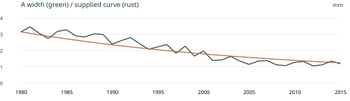
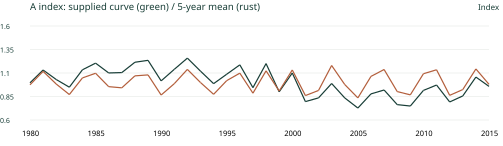

# 樹木年輪で読む環境と歴史

## 第4回 採取・計測と年輪曲線｜90分

採取計画 → 試料・画像・記録 → 境界の観察と計測 → 照合・品質点検 → 標準化と年表作成。不一致があれば、試料と記録へ戻る。

## 採取と記録

目的に合う樹種・立地・配置・個体を選ぶ。必要な個体数と方向数は、問いと試料の条件で変わる。

地点・個体・試料・測線のID、採取日時、位置・方向、樹種、髄・樹皮・欠損、写真、処理・計測条件を対応させる。

試料の内外方向と破片の順序を残す。水浸材などは、状態に応じて保存方法を検討する。

## ミニ演習：尾根と谷のある森林で乾湿変動を調べる

採取する場所・個体・方向と、その理由：

<!-- writing-space -->

必要なメタデータ：

<!-- writing-space -->

選ばない場所があるために生じる限界：

<!-- writing-space -->

本時の数値・図はすべて教材用の合成値・模式例で、実測データではない。

<!-- pagebreak -->

# 演習A 境界の位置から幅へ

既知の10 mmが600 px。図の境界位置は100、160、250、340、460、520、670 px。位置は内側から外側へ増える。

## 較正値：600 ÷ 10 = ______ px/mm

| 輪番号 | 境界 | 差（px） | 幅（mm） |
| --- | --- | --- | --- |
| 1 | B0–B1 |  |  |
| 2 | B1–B2 |  |  |
| 3 | B2–B3 |  |  |
| 4 | B3–B4 |  |  |
| 5 | B4–B5 |  |  |
| 6 | B5–B6 |  |  |

幅（mm）= 隣接する境界位置の差（px）÷ 較正値（px/mm）。

6輪の合計：________ mm ／ 両端からの距離：(670 − 100) ÷ 較正値 = ________ mm

両者が同じでも、境界の読みが正しいと言い切れないのはなぜか。

<!-- writing-space -->

画像のスケールは試料面と同じ平面で確認し、再撮影・拡大縮小・歪みを点検する。画素数や小数桁だけで精度は保証されない。

<!-- pagebreak -->

# 品質点検と照合の記録

単位、桁、内外方向、行の重複・欠落、極端な幅、急な段差を点検する。疑わしい値は削除せず、原画像と試料へ戻る。

## 試料ID・測線ID・画像ファイル：

<!-- writing-space -->

## 確認が必要な輪番号／境界位置：

<!-- writing-space -->

## 観察した事実：

<!-- writing-space -->

## 原因候補と、追加で確認する資料：

<!-- writing-space -->

## 修正する場合の内容・理由・担当者・日付：

<!-- writing-space -->

輪番号と暦年を区別する。局所欠損・偽年輪・読み落としは、組織、別方向、別個体、独立した基準系列で検討する。原データは保存し、候補年代と欠損位置は別に記録する。

<!-- pagebreak -->

# 標準化で何を残すか

標準化（standardization）は、目的に応じて成長の水準や傾向を調整する処理。この演習の指数（ring-width index）は、年輪幅を教材で与えた基準曲線値で割って求める。基準曲線の単位は幅と同じmm、指数に単位はない。

比較の移動平均は中心5年（端は利用できる年のみ）。感度を説明する例で、実務の推奨設定ではない。細かく追う基準は長い変動も除去し得る。

この処理で失われると困る情報は、研究目的によってどう変わるか。

<!-- writing-space -->

<!-- pagebreak -->

# 演習B 指数と年表を作る

L04_B_widths_and_supplied_curves.csvを開く。A列は暦年、B/CはAの幅/基準、D/EはB、F/GはC。H〜Jに各指数、Kに利用可能な指数の平均、Lに個体数を作る。

H2 = IF(ISNUMBER(B2), B2/C2, "") ／ I2 = IF(ISNUMBER(D2), D2/E2, "") ／ J2 = IF(ISNUMBER(F2), F2/G2, "")

K2 = AVERAGE(H2:J2) ／ L2 = COUNT(H2:J2)

2行目から37行目へコピーする。空欄を0で埋めない。以下はPCを使わない場合にも計算できる抜粋。幅÷基準で各指数を求める。

| 年 | 個体 | 幅 mm | 基準 mm | 指数 |
| --- | --- | --- | --- | --- |
| 1998 | A | 2.26560 | 1.88800 |  |
| 1998 | B | 1.92698 | 1.60582 |  |
| 1998 | C | 1.09175 | 1.21306 |  |
| 1999 | A | 1.65469 | 1.83854 |  |
| 1999 | B | 1.24045 | 1.55056 |  |
| 1999 | C | 1.18460 | 1.18460 |  |
| 2000 | A | 1.96986 | 1.79078 |  |
| 2000 | B | 1.94705 | 1.49773 |  |
| 2000 | C | — | — |  |

| 年 | 指数の平均 | 個体数 n |
| --- | --- | --- |
| 1998 |  |  |
| 1999 |  |  |
| 2000 |  |  |

2000年のCを0にすると何が変わるか。利用可能な個体数が少ない期間に、何を追加確認したいか。

<!-- pagebreak -->

# 日英用語と参考リンク

| 用語 | 簡単な説明 |
| --- | --- |
| 成長錐試料（increment core） | 幹から採った棒状の木部試料。 |
| メタデータ（metadata） | 試料・測定・処理を説明する情報。 |
| 測線（measurement path） | 境界間の幅を測る経路。 |
| 空間較正（spatial calibration） | 画素距離を実際の長さへ対応させる。 |
| 品質管理（quality control (QC)） | 観察と数値の不整合を点検する。 |
| 標準化（standardization） | 目的に応じ、成長水準や傾向を調整する。 |
| 傾向除去（detrending） | 選んだ基準に対する変動を取り出す。 |
| 年輪幅指数（ring-width index） | この演習では幅と基準曲線値の比。 |
| 年表（chronology） | 暦年をそろえて集約した系列。 |
| 試料数（sample depth） | 各年に利用できる試料数。個体数と区別する。 |

[R26 試料調整・計測の設備](https://www.usgs.gov/labs/dendrchronology-lab/capabilities)

[R29 画像の長さの較正](https://imagej.net/ij/docs/guide/146-30.html)

[R27 年輪データと処理の説明](https://www.ncei.noaa.gov/pub/data/paleo/treering/treeinfo.pdf)

[R28 dplR：標準化・年表作成](https://cran.r-project.org/web/packages/dplR/dplR.pdf)

[R08 国際年輪データバンク](https://www.ncei.noaa.gov/products/paleoclimatology/tree-ring)

[R09 年輪年代学用語集](https://www.wsl.ch/en/services-produkte/glossary-of-dendrochronology/)

原資料：Speer (2010) 第5章、既存のTurku講義（Field / Lab / Standardization）。外部図版の転載はせず、自作の模式図と合成系列を使用した。