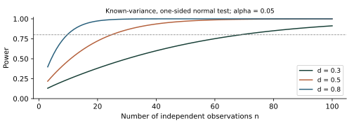

# 1 Notation, means and variation

BG03 Mathematics and statistics for dendrochronology. Optional bilingual support for Lessons 1–8. Draft, 30 October 2026. Read every equation together with its meaning, units and assumptions.

i indexes observations, t calendar years, j trees and k cores. n is the number specified for the equation, not invariably the number of trees. Distinguish population parameters from estimates.

$$
\bar{x}=\frac{1}{n}\sum_{i=1}^{n}x_i
$$

$$
s^2=\frac{1}{n-1}\sum_{i=1}^{n}(x_i-\bar{x})^2,\qquad s=\sqrt{s^2}
$$

$$
\mathrm{SE}(\bar{x})=\frac{s}{\sqrt{n}}
$$

If x is in mm, the mean and standard deviation are in mm, while variance is in mm². This standard-error formula assumes independent, identically distributed observations; do not apply it unchanged to serial years or clustered cores.

$$
z_i=\frac{x_i-\bar{x}}{s}
$$

A z-score is dimensionless centring and scaling, distinct from the ring index w/g. Replacing missing observations with zeros changes both the mean and variance.

<!-- pagebreak -->

# 2 Ring width, geometry and change

For boundary positions p measured along one path, consecutive differences give ring widths. Pixel distances need a calibration factor c in mm per pixel under the relevant imaging conditions.

$$
w_i=p_i-p_{i-1},\qquad w_{i,\mathrm{mm}}=c\,w_{i,\mathrm{pixel}}
$$

For previous radius r and current width w, basal area increment assumes a circular cross-section. Eccentricity, sampling height and radius estimation introduce uncertainty. BAI alone does not determine volume, biomass or carbon.

$$
\mathrm{BAI}=\pi\{(r+w)^2-r^2\}=2\pi rw+\pi w^2
$$

$$
w\ll r\quad\Longrightarrow\quad\mathrm{BAI}\approx2\pi rw
$$

Compare period means M1 and M2 with M1 positive. A small initial value can produce a large percentage change despite a small absolute increment.

$$
G=100\frac{M_2-M_1}{M_1}\ \%,\qquad\Delta=M_2-M_1
$$

In Lesson 6, 1 to 2 mm and 0.1 to 0.2 mm both increase 100%, but increments are 1 and 0.1 mm. Window lengths and release criteria require context.

<!-- pagebreak -->

# 3 Distributions, sample means and intervals

$$
X_i\sim N(\mu,\sigma^2),\qquad\bar{X}\sim N\!\left(\mu,\frac{\sigma^2}{n}\right)
$$

These distributions hold for independent normal observations. Large-sample approximations can extend beyond normal data under conditions, but dependence, heavy tails and small samples need care.

$$
Z=\frac{\bar{X}-\mu}{\sigma/\sqrt{n}}\sim N(0,1)
$$

$$
T=\frac{\bar{X}-\mu}{S/\sqrt{n}}\sim t_{n-1}
$$

Distinguish known population standard deviation in Z from estimated standard deviation in T. The t result is exact for independent normal observations, with n−1 degrees of freedom.

$$
\bar{x}\ \pm\ t_{1-\alpha/2,n-1}\frac{s}{\sqrt{n}}
$$

This confidence procedure has the stated long-run coverage of the population mean. It does not mean that the fixed parameter itself varies with a 95% probability inside this particular interval.

<!-- pagebreak -->

# 4 Type I error, Type II error and power

Define H0 and H1 together with the target population. The decision is to reject or not reject H0. Failure to reject does not prove the null hypothesis.

| Actual state | Reject H0 | Do not reject H0 |
| --- | --- | --- |
| H0 true | Type I error | Correct non-rejection |
| Specified H1 true | Detection | Type II error |

$$
\alpha=P(\mathrm{reject}\ H_0\mid H_0\ \mathrm{true})
$$

$$
\beta(\theta)=P_\theta(\mathrm{do\ not\ reject}\ H_0),\quad\theta\in H_1
$$

$$
\mathrm{Power}(\theta)=1-\beta(\theta)
$$

Alpha is a prespecified significance level, an error probability or its bound. Beta and power depend on a specified alternative effect, sample size, variability and test. Alpha and beta do not sum to one.

In a growth comparison, detecting a difference under no true difference is Type I error; missing a specified real difference is Type II error. Observational differences still require a separate causal interpretation.

<!-- pagebreak -->

# 5 Rejection regions and the two errors

Illustration: independent normal observations with known population standard deviation. Test H0: μ=μ0 against the one-sided alternative μ>μ0 and specify an effect δ=μ−μ0>0.

$$
c=z_{1-\alpha},\quad Z>c\ \Longrightarrow\ \mathrm{reject}\ H_0
$$

$$
Z\mid\delta\sim N\!\left(\frac{\delta\sqrt{n}}{\sigma},1\right)
$$

$$
\beta(\delta)=\Phi\!\left(z_{1-\alpha}-\frac{\delta\sqrt{n}}{\sigma}\right)
$$

Red shows the rejection probability under H0; blue shows non-rejection under the specified alternative. Phi is the standard normal cumulative distribution. Beta changes with the chosen effect. The figure shows theoretical distributions, not measured data.

<!-- pagebreak -->

# 6 Effect size, sample size and power

$$
d=\frac{\delta}{\sigma},\quad\mathrm{Power}(d,n)=1-\Phi(z_{1-\alpha}-d\sqrt{n})
$$

d scales the effect by the population standard deviation. These design equations apply to the preceding known-variance, one-sided normal test, not unchanged to unknown-variance t tests or paired data.

$$
n\ \geq\ \left(\frac{z_{1-\alpha}+z_{1-\beta_*}}{d}\right)^2
$$

For target beta 0.20, alpha 0.05 and d=0.5, round n up to 25. Power is about 0.804. Lowering alpha to 0.01 with the same n and d reduces power to about 0.569.

Define whether the independent unit is a year, tree or site before increasing n. More cores from the same tree do not add independent trees. Choose effect size and required precision for their biological relevance.

<!-- pagebreak -->

# 7 P-values, t tests and scientific meaning

$$
t_{\mathrm{obs}}=\frac{\bar{x}-\mu_0}{s/\sqrt{n}}
$$

$$
p_{\mathrm{two\ sided}}=2\{1-F_{t_{n-1}}(|t_{\mathrm{obs}}|)\}
$$

A p-value is the probability, under H0 and test assumptions, of a selected statistic at least as extreme as observed. This equation is for a two-sided one-sample t test with independent normal data. Choose direction before inspecting results.

The p-value is not the probability that H0 is true or that chance alone produced the finding. A non-significant result does not establish zero or negligible effect. Equivalence requires a separate design with meaningful prespecified bounds.

$$
\widehat{\delta}=\bar{x}-\mu_0
$$

Report the effect estimate, interval, units and sampling design. A small difference can be significant with abundant data, while an important effect may be missed with sparse noisy data. Statistical significance differs from biological or historical importance.

<!-- pagebreak -->

# 8 Correlation, crossdating and sign agreement

$$
r=\frac{\sum_i(x_i-\bar{x})(y_i-\bar{y})}{\sqrt{\sum_i(x_i-\bar{x})^2\sum_i(y_i-\bar{y})^2}}
$$

Pearson correlation uses paired years and is undefined if either series has zero variance. Adding constants or positive scaling leaves it unchanged. Inspect scatterplots for nonlinearity, outliers and dependence.

$$
r_\ell=\mathrm{corr}(x_t,y_{t+\ell})
$$

Changing lag changes the overlap available for comparison. A high correlation alone does not establish a calendar date; inspect features, anatomy, replication and reference anchoring.

$$
\mathrm{GLK}=\frac{\sum_{t\in A}\mathbf{1}\{\Delta x_t\Delta y_t>0\}}{|A|}
$$

Here A contains usable consecutive-year pairs with nonzero changes in both series. This sign-agreement definition excludes ties; document software conventions because tie handling can differ.

$$
t_r=r\sqrt{\frac{n-2}{1-r^2}}
$$

The usual zero-correlation t test assumes independent bivariate-normal pairs, among other conditions. Consecutive tree-ring years should not automatically count as independent pairs.

<!-- pagebreak -->

# 9 Indexing, cores, trees and chronologies

$$
I_{jkt}=\frac{w_{jkt}}{g_{jk}(t)},\qquad g_{jk}(t)>0
$$

w and its reference growth curve g share length units, so I is dimensionless and differs from a z-score. The reference curve affects retained timescales.

$$
\bar{I}_{jt}=\frac{1}{K_{jt}}\sum_{k\in C_{jt}}I_{jkt}
$$

$$
C_t=\frac{1}{n_t}\sum_{j\in J_t}\bar{I}_{jt}
$$

This example first averages available cores within each tree, then equally weights available independent trees. K counts usable cores and n_t counts trees for that year. Other weighting designs exist and should be documented.

$$
C_t=\frac{\sum_j a_{jt}\bar{I}_{jt}}{\sum_j a_{jt}},\qquad a_{jt}\geq0
$$

Assign zero weight to missing observations rather than adding an observed value of zero. Declining early replication can change variance and signal reliability.

<!-- pagebreak -->

# 10 Chronology signal, SNR and EPS

$$
X_j(t)=S(t)+\varepsilon_j(t)
$$

A shared-signal model assumes common signal S and mutually uncorrelated noise with comparable variance. The following measures depend on this model; they are not probabilities that dating or climate interpretation is correct.

$$
\bar{r}=\frac{2}{n(n-1)}\sum_{i<j}r_{ij}
$$

$$
\mathrm{SNR}=\frac{n\bar{r}}{1-\bar{r}}
$$

$$
\mathrm{EPS}=\frac{n\bar{r}}{1+(n-1)\bar{r}}=\frac{\mathrm{SNR}}{1+\mathrm{SNR}}
$$

Mean inter-series correlation is r-bar; SNR is signal-to-noise ratio; EPS is expressed population signal. n denotes independent replicate units in the model. Distinguish cores from trees and report the correlation period and missing-data treatment.

For n=10 and r-bar=0.4, SNR is about 6.667 and EPS about 0.870. Passing a threshold alone does not establish suitability for every purpose. Check whether the shared-signal assumptions are appropriate first.

<!-- pagebreak -->

# 11 Simple regression and least squares

$$
y_i=a+bx_i+\epsilon_i,\qquad\hat{y}_i=\hat{a}+\hat{b}x_i
$$

$$
\hat{b}=\frac{\sum_i(x_i-\bar{x})(y_i-\bar{y})}{S_{xx}},\quad S_{xx}=\sum_i(x_i-\bar{x})^2
$$

$$
\hat{a}=\bar{y}-\hat{b}\bar{x}
$$

$$
\mathrm{SSE}=\sum_i(y_i-\hat{y}_i)^2,\quad s_e^2=\frac{\mathrm{SSE}}{n-2}
$$

x is the predictor and y the response. Least squares minimizes SSE. Slope units are response units per predictor unit. Require n>2 and positive Sxx. Residuals y−ŷ have the opposite sign to prediction errors defined as ŷ−y.

$$
R^2=1-\frac{\mathrm{SSE}}{\sum_i(y_i-\bar{y})^2}
$$

In-sample least squares with an intercept has R²=r² for simple regression. Do not transfer this identity mechanically to test periods, no-intercept models or other definitions. Inspect linearity, dependence, variance and influential observations.

<!-- pagebreak -->

# 12 Independent verification and reference predictions

$$
e_t=\hat{y}_t-y_t,\qquad\mathrm{Bias}=\frac{1}{m}\sum_{t\in V}e_t
$$

$$
\mathrm{RMSE}=\sqrt{\frac{1}{m}\sum_{t\in V}e_t^2},\quad\mathrm{MAE}=\frac{1}{m}\sum_{t\in V}|e_t|
$$

V denotes verification years and m usable pairs. RMSE, MAE and bias share response units. Report correlation alongside error measures, since it misses constant bias. A model adjusted after seeing test data is no longer independently tested by those data.

$$
\mathrm{RE}=1-\frac{\sum_{t\in V}(y_t-\hat{y}_t)^2}{\sum_{t\in V}(y_t-\bar{y}_{C})^2}
$$

$$
\mathrm{CE}=1-\frac{\sum_{t\in V}(y_t-\hat{y}_t)^2}{\sum_{t\in V}(y_t-\bar{y}_{V})^2}
$$

RE compares with the calibration mean; CE with the verification mean. With positive denominators, values above zero indicate smaller squared error than the respective constant baseline. Values can be negative. No single statistic proves overall validity.

<!-- pagebreak -->

# 13 Confidence and prediction intervals in regression

$$
\hat{y}_0=\hat{a}+\hat{b}x_0,\qquad h_0=\frac{1}{n}+\frac{(x_0-\bar{x})^2}{S_{xx}}
$$

$$
\mathrm{CI}_{\mathrm{mean}}:\quad\hat{y}_0\ \pm\ t_{1-\alpha/2,n-2}s_e\sqrt{h_0}
$$

$$
\mathrm{PI}_{\mathrm{new}}:\quad\hat{y}_0\ \pm\ t_{1-\alpha/2,n-2}s_e\sqrt{1+h_0}
$$

A confidence interval estimates the conditional mean response at x0. A prediction interval also includes variation in a new individual response and is wider under the same conditions.

Exact application assumes a correct linear model with independent, homoscedastic normal errors. These formulas do not automatically include dating or predictor error, response change in the past, or uncertainty from detrending choices.

For Lesson 7's four synthetic calibration points, x0=1 gives 10°C, residual standard error about 0.1414°C and 2 degrees of freedom. The 95% mean-CI half-width is about 0.304°C; the new-observation PI half-width about 0.680°C. These are arithmetic illustrations.

<!-- pagebreak -->

# 14 Autocorrelation and effective information

$$
X_t-\mu=\phi(X_{t-1}-\mu)+\eta_t,\qquad |\phi|<1
$$

An AR(1) relates a value to its predecessor in a stationary model. Innovations have zero mean and no serial correlation. Do not assume stationarity for a series with trend, periodicity or structural change.

$$
\rho(k)=\phi^k
$$

$$
\mathrm{Var}(\bar{X})=\frac{\sigma_X^2}{n}\left[1+2\sum_{k=1}^{n-1}\left(1-\frac{k}{n}\right)\rho(k)\right]
$$

$$
n_{\mathrm{eff}}\approx n\frac{1-\phi}{1+\phi}\quad\mathrm{(large\ }n\mathrm{,\ AR(1))}
$$

Positive serial correlation can reduce the information about a mean. This effective-n expression is a large-sample AR(1) approximation for the mean variance, not a universal correction for every statistic or a direct plug-in formula for correlation tests.

For n=100 and phi=0.6, the approximation gives effective n=25. Consider time-block validation or resampling that preserves dependence. Core, tree and site clustering is an additional form of dependence, distinct from temporal autocorrelation.

<!-- pagebreak -->

# 15 Multiple testing and exploratory searches

$$
P(\mathrm{at\ least\ one\ false\ rejection})=1-(1-\alpha)^m
$$

This formula assumes all m nulls are true and tests independent. With alpha 0.05 and m=24 it is about 0.708. Actual monthly or lag tests can be correlated, so this is not automatically their error probability.

$$
\alpha_{\mathrm{individual}}=\frac{\alpha_{\mathrm{family}}}{m}
$$

Bonferroni controls the familywise error rate without requiring independent tests, provided individual p-values are valid. It can be conservative. Define the family of hypotheses before choosing the correction.

$$
k=\max\left\{i:p_{(i)}\leq\frac{iq}{m}\right\}
$$

Advanced: the BH selection rule targets false discovery rate, not familywise error. If no index qualifies, reject none. Check conditions such as independence or suitable positive dependence before invoking its guarantee.

In tree-ring research, searching months, variables, lags, processing methods and sites creates selection. Corrections do not replace a search record and genuinely unused verification data.

<!-- pagebreak -->

# 16 Matrices, principal components and resampling

$$
\mathbf{y}=\mathbf{X}\boldsymbol{\beta}+\boldsymbol{\epsilon}
$$

$$
\hat{\boldsymbol{\beta}}=(\mathbf{X}^{\mathsf{T}}\mathbf{X})^{-1}\mathbf{X}^{\mathsf{T}}\mathbf{y}
$$

Rows of X are observations and columns predictors; include a column of ones for an intercept. The displayed inverse requires independent columns. Numerical implementations should use stable decompositions.

$$
\mathbf{S}=\frac{1}{n-1}\mathbf{Z}^{\mathsf{T}}\mathbf{Z},\quad\mathbf{S}\mathbf{v}_k=\lambda_k\mathbf{v}_k
$$

$$
\mathbf{u}_k=\mathbf{Z}\mathbf{v}_k
$$

Z is a centred data matrix. PCA summarizes orthogonal directions of variance, with results depending on scaling. Orthogonality or zero correlation does not generally imply statistical independence or causation.

Bootstrap design must specify the resampling unit. Resampling trees and time blocks address different uncertainties. Randomly rearranging individual time-series rows destroys temporal dependence.

Using verification responses or performance to choose variables, PCA component counts or detrending settings compromises independence. Specify choices estimated within training. State how dating and response-independent construction of the chronology are treated for the research objective.

<!-- pagebreak -->

# 17 Worked example and exercises

Use the same synthetic example as Lesson 7: calibration x values 0.7,0.9,1.1,1.3 and y values 8.9,9.5,10.3,11.3°C. These are teaching values, not observations from a forest.

$$
\bar{x}=1,\quad\bar{y}=10,\quad S_{xx}=0.20,\quad\hat{b}=4,\quad\hat{a}=6
$$

$$
\mathrm{SSE}=0.04,\quad s_e^2=0.02,\quad R^2=1-0.04/3.24\approx0.98765
$$

Verification x values are 0.8,1.0,1.2 and observed y values 9.0,10.1,10.9°C. Compare A=6+4x, B=A+1 and constant 10.

| Prediction | RMSE (°C) | Bias (°C) |
| --- | --- | --- |
| A | 0.1414 | 0 |
| B | 1.0100 | 1 |
| Constant 10 | 0.7789 | 0 |

A and B both correlate about 0.99587 with observations; the constant has undefined correlation. Calibration and verification means both equal 10 here, so A has RE=CE about 0.96703. The baselines generally differ.

Exercise 1: calculate EPS for n=10 and r-bar=0.4. Exercise 2: what does lowering alpha do to power with n and effect fixed? Exercise 3: does p=0.08 establish no difference?

Answers: about 0.870; power decreases in the stated normal-test design; and no, examine the effect interval and design. The small synthetic example does not establish real research accuracy.

<!-- pagebreak -->

# 18 Terms, references and reading route

Foundations: pages 1–7. Tree-ring applications: pages 8–13. Advanced topics: pages 14–16. Worked example: page 17. Return to individual equations as needed.

Search terms: significance level, Type I error, Type II error, power, effect size, confidence interval, prediction interval, autocorrelation, multiple testing and pseudoreplication.

Foundational text: Illowsky & Dean, Introductory Statistics, OpenStax (local edition ©2017), Chapter 9 and the correlation/regression chapters. Section 9.2 is on PDF pages 512–513 (printed pages 504–505). Explanations, examples and theoretical figures here are newly created.

[OpenStax Introductory Statistics](https://openstax.org/details/books/introductory-statistics) / [NIST tests and intervals](https://www.itl.nist.gov/div898/handbook/eda/section3/eda35.htm) / [NIST tests for a mean](https://www.itl.nist.gov/div898/handbook/prc/section2/prc22.htm)

[NIST least squares](https://www.itl.nist.gov/div898/handbook/pmd/section4/pmd431.htm) / [NIST autocorrelation](https://www.itl.nist.gov/div898/handbook/eda/section3/eda35c.htm)

Tree-ring foundations: Fritts (1976), Tree Rings and Climate, Chapters 6–8; Speer (2010), Fundamentals of Tree-Ring Research, Chapters 6 and 8. EPS: Wigley, Briffa & Jones (1984), Journal of Climate and Applied Meteorology 23:201–213.

[Wigley et al. primary paper](https://www.ltrr.arizona.edu/~ellisqm/outgoing/dendroecology2014/readings/Wigley%20et%20al.%201984_EPS.pdf) / [Lesson 7 Hinoki study](https://doi.org/10.1029/2006GL026170)

Read each equation under its stated assumptions. Research requires checking the estimand, sampling design, missingness, dependence, selection and measurement error, together with software definitions and primary reports.
