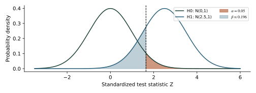

# 1 記号、平均、ばらつき

BG03 年輪年代学のための数学・統計学。日英対応の任意学習資料。初稿・2026年10月30日。第1〜8回の計算や論文読解に戻るために使う。数式の意味、単位、仮定を一緒に読む。

i は観測、t は暦年、j は個体、k はコア、n は当該式で定義した観測数。Nやnが常に「木の本数」とは限らない。母平均μ、母分散σ²と、標本からの推定量を区別する。

$$
\bar{x}=\frac{1}{n}\sum_{i=1}^{n}x_i
$$

$$
s^2=\frac{1}{n-1}\sum_{i=1}^{n}(x_i-\bar{x})^2,\qquad s=\sqrt{s^2}
$$

$$
\mathrm{SE}(\bar{x})=\frac{s}{\sqrt{n}}
$$

x がmmなら平均と標準偏差sはmm、分散s²はmm²。上の標準誤差（standard error）は独立・同分布の観測を前提とする。自己相関のある連続年や、同じ木の複数コアにそのまま使わない。

$$
z_i=\frac{x_i-\bar{x}}{s}
$$

z得点（z-score）は中心化・尺度化した無次元の量。年輪指数w/gとは別の定義。欠測を0に置き換えると、平均・分散の双方が変わる。

<!-- pagebreak -->

# 2 年輪幅、幾何学、変化率

境界の位置pを同じ方向に測った場合、隣接する境界の差が年輪幅。画素単位なら、同じ画像条件で求めた較正係数c（mm/pixel）を用いる。

$$
w_i=p_i-p_{i-1},\qquad w_{i,\mathrm{mm}}=c\,w_{i,\mathrm{pixel}}
$$

前年までの半径rと当年幅wから、円形断面を仮定した断面積増分BAIを求める。実際の偏心や採取高、半径推定には不確実性がある。BAIだけでは体積・バイオマス・炭素量を決められない。

$$
\mathrm{BAI}=\pi\{(r+w)^2-r^2\}=2\pi rw+\pi w^2
$$

$$
w\ll r\quad\Longrightarrow\quad\mathrm{BAI}\approx2\pi rw
$$

前期平均M1と後期平均M2を比較する。M1>0を確認する。元の水準が小さいと、絶対増分が小さくても大きな変化率になる。

$$
G=100\frac{M_2-M_1}{M_1}\ \%,\qquad\Delta=M_2-M_1
$$

第6回の合成例：1→2mmと0.1→0.2mmは共に100%増だが、増分は1mmと0.1mm。窓の長さと判定基準は目的・樹種・直前の成長で検討する。

<!-- pagebreak -->

# 3 分布、標本平均、区間推定

$$
X_i\sim N(\mu,\sigma^2),\qquad\bar{X}\sim N\!\left(\mu,\frac{\sigma^2}{n}\right)
$$

上式は独立な正規分布の観測で成り立つ。母集団が非正規でも、大標本で平均の分布を近似できる条件がある。ただし、自己相関・重い裾・小標本では機械的に近似しない。

$$
Z=\frac{\bar{X}-\mu}{\sigma/\sqrt{n}}\sim N(0,1)
$$

$$
T=\frac{\bar{X}-\mu}{S/\sqrt{n}}\sim t_{n-1}
$$

母標準偏差σが既知のzと、標本標準偏差Sで推定するtを区別する。t分布は独立な正規観測の場合の厳密な結果。自由度（degrees of freedom）はn−1。

$$
\bar{x}\ \pm\ t_{1-\alpha/2,n-1}\frac{s}{\sqrt{n}}
$$

これは母平均の信頼区間（confidence interval）。同じ手続きを繰り返したとき、指定割合で真の母平均を含むという被覆率の意味を持つ。固定された今回のμが95%の確率で動く、という解釈ではない。

<!-- pagebreak -->

# 4 αエラー、βエラー、検出力

帰無仮説（null hypothesis）H0と対立仮説（alternative hypothesis）H1を、対象母集団とともに定義する。H0を棄却するか、棄却しないかを区別する。「棄却しない」はH0の証明ではない。

| 実際の状態 | H0を棄却 | H0を棄却しない |
| --- | --- | --- |
| H0が真 | 第I種の過誤 | 正しい非棄却 |
| 指定したH1が真 | 検出 | 第II種の過誤 |

$$
\alpha=P(\mathrm{reject}\ H_0\mid H_0\ \mathrm{true})
$$

$$
\beta(\theta)=P_\theta(\mathrm{do\ not\ reject}\ H_0),\quad\theta\in H_1
$$

$$
\mathrm{Power}(\theta)=1-\beta(\theta)
$$

αは有意水準（significance level）として事前に設計する上限または確率。βと検出力（power）は、特定の効果の大きさθ、標本数、ばらつき、検定法に依存する。α+β=1という関係はない。

年輪研究の例：本当は成長差がないのに虫害群との差を検出するのが第I種、指定した大きさの差があるのに見落とすのが第II種。観察研究では、差の検出と虫害の因果的効果は別に検討する。

<!-- pagebreak -->

# 5 棄却域と二つの誤りを図で読む

説明用モデル：独立な正規観測、母標準偏差σは既知。H0: μ=μ0に対してH1: μ>μ0の片側検定を行う。効果δ=μ−μ0>0を具体的に指定する。

$$
c=z_{1-\alpha},\quad Z>c\ \Longrightarrow\ \mathrm{reject}\ H_0
$$

$$
Z\mid\delta\sim N\!\left(\frac{\delta\sqrt{n}}{\sigma},1\right)
$$

$$
\beta(\delta)=\Phi\!\left(z_{1-\alpha}-\frac{\delta\sqrt{n}}{\sigma}\right)
$$

図の赤はH0の下での右側棄却確率α、青は指定したH1の下での非棄却確率β。Φは標準正規分布の累積分布関数。別の効果δなら、βの面積は変わる。これは実測データの分布ではなく、仮定した理論分布である。

<!-- pagebreak -->

# 6 効果量、標本数、検出力の設計

$$
d=\frac{\delta}{\sigma},\quad\mathrm{Power}(d,n)=1-\Phi(z_{1-\alpha}-d\sqrt{n})
$$

dは母標準偏差で尺度化した効果量（standardized effect size）。このページは前頁と同じ、σ既知の片側正規検定に限った設計式であり、未知σのt検定や対応のあるデータに同じ数値を流用しない。

$$
n\ \geq\ \left(\frac{z_{1-\alpha}+z_{1-\beta_*}}{d}\right)^2
$$

目標β*=0.20、α=0.05、d=0.5ならnは切り上げて25。実際の検出力は約0.804。αを0.01に下げ、nとdを同じにすると検出力は約0.569へ下がる。

nを増やせばよいと考える前に、独立な単位は年か、木か、地点かを決める。同じ木からのコアを増やすだけでは、独立な木の標本数は増えない。効果量と必要な精度は、生物学的な意味から設定する。

<!-- pagebreak -->

# 7 p値、t検定、科学的な意味

$$
t_{\mathrm{obs}}=\frac{\bar{x}-\mu_0}{s/\sqrt{n}}
$$

$$
p_{\mathrm{two\ sided}}=2\{1-F_{t_{n-1}}(|t_{\mathrm{obs}}|)\}
$$

p値（p-value）はH0と検定の仮定の下で、選んだ統計量が観測値以上に極端となる確率。上式は独立正規観測の母平均に対する両側t検定。片側か両側かは結果を見て都合よく変えない。

pは「H0が真である確率」でも「偶然だけで結果が生じた確率」でもない。p>αだけで効果が0、あるいは実用上十分小さいと結論しない。等価性を主張するなら、意味のある限界幅を先に定める別の設計が必要。

$$
\widehat{\delta}=\bar{x}-\mu_0
$$

効果の推定値と区間、標本設計、単位を添える。小さな差も大標本では有意になり、大きな差もばらつきや資料不足で検出できないことがある。統計的有意性と生物学的・歴史的な重要性は異なる。

<!-- pagebreak -->

# 8 相関、照合、符号の一致

$$
r=\frac{\sum_i(x_i-\bar{x})(y_i-\bar{y})}{\sqrt{\sum_i(x_i-\bar{x})^2\sum_i(y_i-\bar{y})^2}}
$$

対応する年の組だけで計算するPearsonの相関係数。どちらかの分散が0なら定義されない。定数の加算では変わらず、正の倍率でも変わらない。非線形の関連、外れ値、自己相関を図とともに確認する。

$$
r_\ell=\mathrm{corr}(x_t,y_{t+\ell})
$$

時差ℓを変える照合では、候補ごとの重複長が変わる。高い相関一つだけで暦年を決めず、特徴年、木材組織、反復、基準年表への固定を確かめる。

$$
\mathrm{GLK}=\frac{\sum_{t\in A}\mathbf{1}\{\Delta x_t\Delta y_t>0\}}{|A|}
$$

ここでΔxは隣接年の差、Aは両系列とも差が0でない有効な年の組と定義した。増減一致率（Gleichläufigkeit）のこの定義では同値を除外する。ソフトによる同値の扱いの違いを記録する。

$$
t_r=r\sqrt{\frac{n-2}{1-r^2}}
$$

相関0の通常のt検定には、独立な二変量正規の組などの仮定がある。年輪時系列のn年を、そのまま独立なn組とみなさない。

<!-- pagebreak -->

# 9 指数化、コア、個体、年表

$$
I_{jkt}=\frac{w_{jkt}}{g_{jk}(t)},\qquad g_{jk}(t)>0
$$

wは年輪幅、gは基準となる成長曲線で、ともに同じ長さの単位。年輪指数Iは無次元。z得点とは異なる。基準曲線の選び方は、残る時間スケールに影響する。

$$
\bar{I}_{jt}=\frac{1}{K_{jt}}\sum_{k\in C_{jt}}I_{jkt}
$$

$$
C_t=\frac{1}{n_t}\sum_{j\in J_t}\bar{I}_{jt}
$$

この例では、まず個体内の有効なコア集合Cを平均し、その年の独立した木の集合Jを等重みで平均する。Kは有効コア数、n_tは有効個体数。異なる重みの設計もあるので、使用した集約法を記す。

$$
C_t=\frac{\sum_j a_{jt}\bar{I}_{jt}}{\sum_j a_{jt}},\qquad a_{jt}\geq0
$$

欠測した値の重みは0とし、値そのものを0として足さない。古い部分で個体数が減ると、分散や共通信号の確かさも変わり得る。

<!-- pagebreak -->

# 10 年表の信号、SNR、EPS

$$
X_j(t)=S(t)+\varepsilon_j(t)
$$

説明用の共通信号モデル。各系列が共通の信号Sを持ち、ノイズは互いに無相関で、同じ分散などの条件を置く。以下はモデルに基づく指標であり、年代や気候解釈の正しさの確率ではない。

$$
\bar{r}=\frac{2}{n(n-1)}\sum_{i<j}r_{ij}
$$

$$
\mathrm{SNR}=\frac{n\bar{r}}{1-\bar{r}}
$$

$$
\mathrm{EPS}=\frac{n\bar{r}}{1+(n-1)\bar{r}}=\frac{\mathrm{SNR}}{1+\mathrm{SNR}}
$$

r̄は系列間の平均相関、SNRは信号対雑音比、EPSはexpressed population signal。nはモデル上の独立な反復単位。コアを木と混同しない。n≥2、r̄の推定期間と欠測の扱いも明示する。

n=10、r̄=0.4ならSNR≈6.667、EPS≈0.870。EPSのある閾値を越えるだけで、全目的に十分な年表とは決まらない。負の平均相関など、共通信号モデルが適切でない状況を先に点検する。

<!-- pagebreak -->

# 11 単回帰と最小二乗法

$$
y_i=a+bx_i+\epsilon_i,\qquad\hat{y}_i=\hat{a}+\hat{b}x_i
$$

$$
\hat{b}=\frac{\sum_i(x_i-\bar{x})(y_i-\bar{y})}{S_{xx}},\quad S_{xx}=\sum_i(x_i-\bar{x})^2
$$

$$
\hat{a}=\bar{y}-\hat{b}\bar{x}
$$

$$
\mathrm{SSE}=\sum_i(y_i-\hat{y}_i)^2,\quad s_e^2=\frac{\mathrm{SSE}}{n-2}
$$

xは説明変数、yは応答変数。最小二乗法（ordinary least squares）はSSEを最小化する。傾きの単位はyの単位/xの単位。n>2とSxx>0が必要。残差をy−ŷとし、予測誤差ŷ−yとは符号が逆と定義する。

$$
R^2=1-\frac{\mathrm{SSE}}{\sum_i(y_i-\bar{y})^2}
$$

切片を含む同じ標本内の最小二乗単回帰ではR²=r²となる。未使用期間の成績、切片なしのモデル、異なる定義へ機械的にこの関係を広げない。独立性・線形性・等分散性と外れ値を点検する。

<!-- pagebreak -->

# 12 独立検証：誤差と基準の比較

$$
e_t=\hat{y}_t-y_t,\qquad\mathrm{Bias}=\frac{1}{m}\sum_{t\in V}e_t
$$

$$
\mathrm{RMSE}=\sqrt{\frac{1}{m}\sum_{t\in V}e_t^2},\quad\mathrm{MAE}=\frac{1}{m}\sum_{t\in V}|e_t|
$$

Vは検証期間、mは有効な組数。RMSE、MAE、Biasはいずれもyと同じ単位。相関は定数の偏りを捉えないので併記する。検証データを見て調整したモデルは、その期間に対して独立ではない。

$$
\mathrm{RE}=1-\frac{\sum_{t\in V}(y_t-\hat{y}_t)^2}{\sum_{t\in V}(y_t-\bar{y}_{C})^2}
$$

$$
\mathrm{CE}=1-\frac{\sum_{t\in V}(y_t-\hat{y}_t)^2}{\sum_{t\in V}(y_t-\bar{y}_{V})^2}
$$

REは較正期間Cの平均を基準、CEは検証期間Vの平均を基準とする。分母>0で定義され、0より大きければその基準の一定値より二乗誤差が小さい。負にもなり得る。手法の妥当性全体を一つの値で証明しない。

<!-- pagebreak -->

# 13 平均応答の信頼区間と予測区間

$$
\hat{y}_0=\hat{a}+\hat{b}x_0,\qquad h_0=\frac{1}{n}+\frac{(x_0-\bar{x})^2}{S_{xx}}
$$

$$
\mathrm{CI}_{\mathrm{mean}}:\quad\hat{y}_0\ \pm\ t_{1-\alpha/2,n-2}s_e\sqrt{h_0}
$$

$$
\mathrm{PI}_{\mathrm{new}}:\quad\hat{y}_0\ \pm\ t_{1-\alpha/2,n-2}s_e\sqrt{1+h_0}
$$

平均応答の信頼区間（confidence interval）は、x0での条件付き平均の推定を扱う。予測区間（prediction interval）は新しい一つの応答値の誤差も含むため、同じ条件なら広い。

上式の厳密な適用には、正しい線形モデルと独立・等分散・正規の誤差などを置く。年輪の年代・計測誤差、xの不確かさ、過去での応答変化、標準化の選択を自動的には含まない。

第7回の合成較正4点では、x0=1で推定10℃、s_e≈0.1414℃、自由度2。95%平均CIの半幅は約0.304℃、新しい観測のPI半幅は約0.680℃。少数点での算術例であり、実際の復元の区間ではない。

<!-- pagebreak -->

# 14 自己相関と有効な情報量

$$
X_t-\mu=\phi(X_{t-1}-\mu)+\eta_t,\qquad |\phi|<1
$$

AR(1)は、現在の値が一年前の値と関係する定常モデル。ηは平均0で時系列的に無相関な革新とする。トレンド、周期、変化点がある系列を先に定常と決めつけない。

$$
\rho(k)=\phi^k
$$

$$
\mathrm{Var}(\bar{X})=\frac{\sigma_X^2}{n}\left[1+2\sum_{k=1}^{n-1}\left(1-\frac{k}{n}\right)\rho(k)\right]
$$

$$
n_{\mathrm{eff}}\approx n\frac{1-\phi}{1+\phi}\quad\mathrm{(large\ }n\mathrm{,\ AR(1))}
$$

正の自己相関では、独立データと同じn年あっても平均の情報量が少なくなり得る。上の有効標本数は平均の分散に関するAR(1)の大標本近似であり、相関検定や全ての統計量へそのまま流用する公式ではない。

例：n=100、φ=0.6なら近似n_eff=25。時系列の区間分割やブロック単位の再標本化など、依存を保つ方法を検討する。コア・木・地点の階層的な依存は、時間の自己相関とは別に扱う。

<!-- pagebreak -->

# 15 多重検定と探索の影響

$$
P(\mathrm{at\ least\ one\ false\ rejection})=1-(1-\alpha)^m
$$

上式はm個全てのH0が真で、検定が独立の場合。α=0.05、m=24なら約0.708。実際の月別気候や時差の検定は相関し得るので、この数値がそのまま実際の確率ではない。

$$
\alpha_{\mathrm{individual}}=\frac{\alpha_{\mathrm{family}}}{m}
$$

Bonferroni法は各検定のp値が妥当なら、独立性を要求せずに家族全体の第I種過誤率を抑える方法。保守的になる場合もある。何を一つの検定群とするかを事前に明確にする。

$$
k=\max\left\{i:p_{(i)}\leq\frac{iq}{m}\right\}
$$

発展：これはBH法の選択式で、該当するiがなければ棄却なし。FDR（false discovery rate）を目標とし、FWERとは違う。独立性または適切な正の依存など、保証される条件を確認する。

年輪研究では、多数の月、変数、時差、標準化、地点を試して最良の結果だけ示す選択に注意する。補正だけでなく、探索の記録と未使用資料による確認が必要。

<!-- pagebreak -->

# 16 行列、主成分、再標本化

$$
\mathbf{y}=\mathbf{X}\boldsymbol{\beta}+\boldsymbol{\epsilon}
$$

$$
\hat{\boldsymbol{\beta}}=(\mathbf{X}^{\mathsf{T}}\mathbf{X})^{-1}\mathbf{X}^{\mathsf{T}}\mathbf{y}
$$

行列Xの各行は観測、各列は説明変数。切片を含めるなら1の列を置く。逆行列を使う式は列が独立であることを要する。実際の計算では数値的に安定な分解を使う。

$$
\mathbf{S}=\frac{1}{n-1}\mathbf{Z}^{\mathsf{T}}\mathbf{Z},\quad\mathbf{S}\mathbf{v}_k=\lambda_k\mathbf{v}_k
$$

$$
\mathbf{u}_k=\mathbf{Z}\mathbf{v}_k
$$

Zは中心化した変数行列。主成分分析（PCA）は分散の大きい直交方向へまとめる。尺度化の有無で結果が変わる。数学的な直交・無相関は、一般には確率的独立や因果を意味しない。

ブートストラップ（bootstrap）では再標本化する単位を設計する。木を独立単位とするか、年のブロックを使うかで扱う不確実性が異なる。時系列を一行ずつ無作為に並べ替えると依存を壊す。

検証の応答値や成績を使って変数・PCA成分数・標準化設定を選べば、独立した確認ではない。訓練内で推定する選択・変換を明示する。年代照合や、応答値を使わず全期間で作る年表の扱いは、研究目的と検証設計に即して記す。

<!-- pagebreak -->

# 17 計算例と短い演習

以下は第7回と同じ合成例。較正のxは0.7,0.9,1.1,1.3、yは8.9,9.5,10.3,11.3℃。全て説明用の値であり、森林の実測ではない。

$$
\bar{x}=1,\quad\bar{y}=10,\quad S_{xx}=0.20,\quad\hat{b}=4,\quad\hat{a}=6
$$

$$
\mathrm{SSE}=0.04,\quad s_e^2=0.02,\quad R^2=1-0.04/3.24\approx0.98765
$$

検証xは0.8,1.0,1.2、観測yは9.0,10.1,10.9℃。A=6+4x、B=A+1、一定値10と比べる。

| 予測 | RMSE（℃） | Bias（℃） |
| --- | --- | --- |
| A | 0.1414 | 0 |
| B | 1.0100 | 1 |
| 一定値10 | 0.7789 | 0 |

AとBの相関は共に約0.99587。定数の相関は未定義。較正平均と検証平均が共に10なので、AのREとCEはこの例では共に約0.96703。一般には二つの基準が異なる。

問1：n=10、r̄=0.4のEPSを求める。問2：αを下げたとき、同じn・効果量で検出力はどうなるか。問3：p=0.08から「差がない」と言えるか。

解：1は約0.870。2はこの片側正規設計では下がる。3は言えず、効果の区間と検出力・設計を確認する。小標本の合成例で実際の研究精度を主張しない。

<!-- pagebreak -->

# 18 用語、参照資料、読む順序

基礎：1〜7頁。年輪研究への応用：8〜13頁。発展：14〜16頁。計算例：17頁。疑問の出た式から戻ってもよい。

有意水準（significance level）、第I種の過誤（Type I error）、第II種の過誤（Type II error）、検出力（power）、効果量（effect size）、信頼区間（confidence interval）、予測区間（prediction interval）、自己相関（autocorrelation）、多重検定（multiple testing）、擬似反復（pseudoreplication）。

基礎文献：Illowsky & Dean, Introductory Statistics, OpenStax（手元版©2017）、第9章9.1〜9.3、相関・回帰の章。第9.2節は手元PDFの512〜513頁（印刷504〜505頁）。本文や図は転載せず、説明・計算例・理論分布図を新規作成した。

[OpenStax Introductory Statistics](https://openstax.org/details/books/introductory-statistics) / [NIST 検定・区間推定](https://www.itl.nist.gov/div898/handbook/eda/section3/eda35.htm) / [NIST 母平均の検定](https://www.itl.nist.gov/div898/handbook/prc/section2/prc22.htm)

[NIST 最小二乗](https://www.itl.nist.gov/div898/handbook/pmd/section4/pmd431.htm) / [NIST 自己相関](https://www.itl.nist.gov/div898/handbook/eda/section3/eda35c.htm)

年輪の基礎：Fritts（1976）Tree Rings and Climate 第6〜8章。Speer（2010）Fundamentals of Tree-Ring Research 第6・8章。EPS：Wigley, Briffa & Jones（1984）, Journal of Climate and Applied Meteorology 23:201–213。

[Wigleyほかの原論文](https://www.ltrr.arizona.edu/~ellisqm/outgoing/dendroecology2014/readings/Wigley%20et%20al.%201984_EPS.pdf) / [第7回のヒノキ研究](https://doi.org/10.1029/2006GL026170)

各式は指定した仮定の下で読む。研究では推定対象、標本設計、欠測、依存、探索、測定誤差を確かめ、使用ソフトの定義と原報告を確認する。
